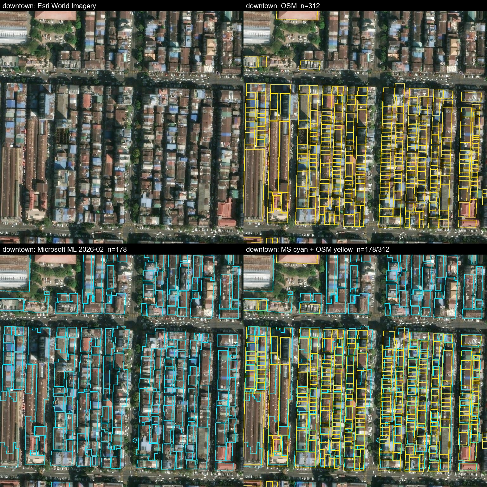
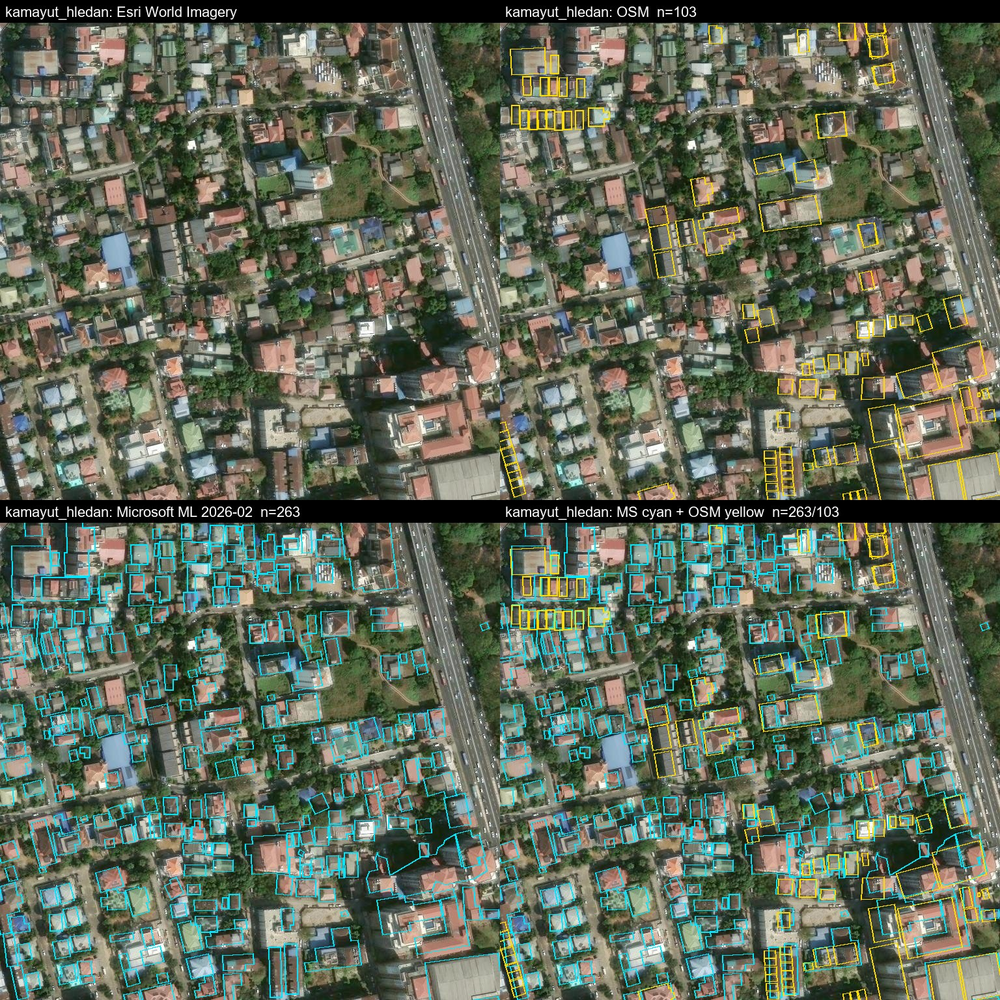
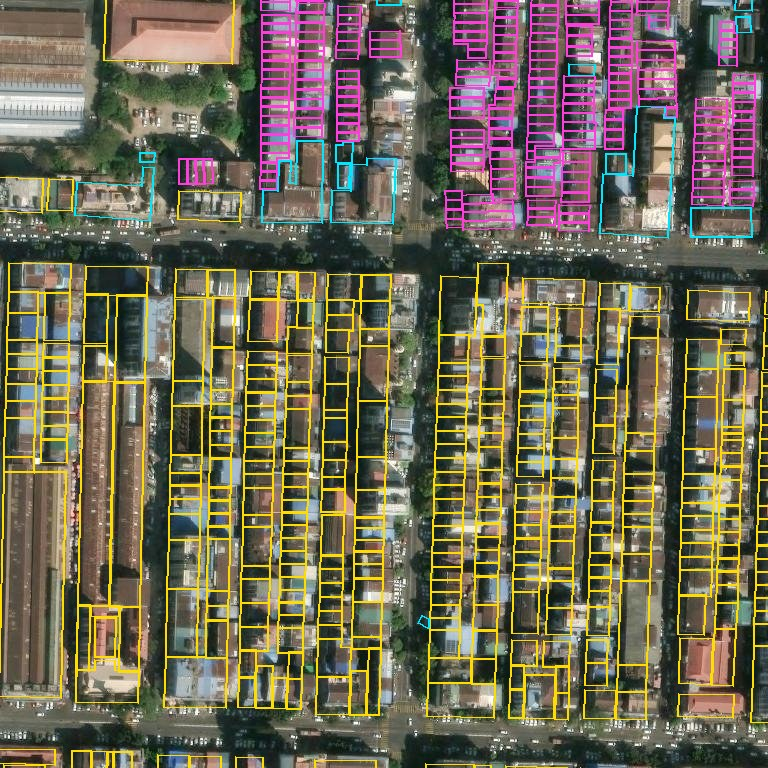
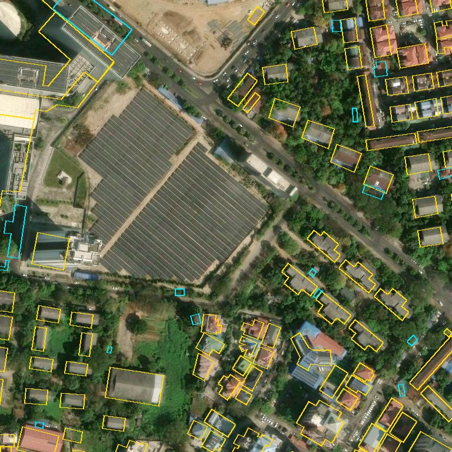

# Real building footprints for Yangon (16 Nov 2026)

Box: lon 96.095-96.235, lat 16.75-16.89 (230.9 km²). Why: the audit found about 80% of the map's 116,000 buildings were invented infill, because OSM has only about 54,000 outlines in the box.

Script: `tools/yangon/city/footprints.py` (run `python footprints.py --preview`, 85 s). Output: `build/footprints/ygn_footprints.json` (56.6 MB, 224,831 buildings).

## 1. What exists and what was downloaded

| Source | Covers Yangon? | Kept in box | Licence | File |
|---|---|---|---|---|
| OpenStreetMap (`build/osm_ygn/buildings.json`, extract 2026-11-12) | partly: downtown well, most townships thin | 53,738 | ODbL 1.0 | (existing) |
| Microsoft Global ML Building Footprints, release 2026-02-03, quadkey 132201222 (49 MB gz) | **yes, everywhere** | 196,548 | ODbL 1.0 | `ms_buildings.geojson` (raw tile in `raw/ms/`) |
| Overture Maps buildings 2026-10-21.0 (S3 GeoParquet via DuckDB) | yes, but only OSM 51,379 + Microsoft 150,777 (an older, OSM-deduplicated Microsoft cut), so it adds nothing new | 202,156 | ODbL 1.0 for these two sources (Overture's own schema is CDLA-Permissive 2.0) | `overture_buildings.geojson` |
| Google Open Buildings v3 polygons | **no**. Myanmar is not in v3. The S2 level-4 cell over Yangon (`30d`, 822 MB gz) was streamed whole: 8,538,264 rows, 0 inside the box. | 0 | CC BY 4.0 or ODbL (user's choice) | none |
| Google Open Buildings 2.5D Temporal (heights, 2016-2023) | **no**. Myanmar is not on its country list ("sensitive areas, including conflict zones, were omitted"). | - | CC BY 4.0 / ODbL | none |

Heights: none of the sources has heights for Yangon. Microsoft's `height` and `confidence` are -1 on all 206k rows of the tile. Overture has heights on 698 buildings and floor counts on 1,770, all copied from OSM tags that we already read. So floors are **estimated** (see 4).

## 2. Comparison in 5 sample spots

Each spot is 3 x 3 Esri World Imagery z18 tiles (about 0.19 km²). Sheets: imagery | OSM (yellow) | Microsoft (cyan) | both. The merged result is drawn in `samples/merged_<spot>.jpg` (yellow OSM, cyan Microsoft, magenta split plots).

| Spot | OSM n (/km²) | Microsoft n (/km²) | Overture n | OSM cover | MS cover | MS not in OSM | OSM not in MS | MS polygons swallowing 3+ OSM buildings | **Merged n (/km²)** |
|---|---|---|---|---|---|---|---|---|---|
| Downtown (Bogyoke Market blocks) | 312 (1,629) | 178 (930) | 354 | 41% | 50% | 44 | 7 | **39** | 546 (2,847) |
| Kamayut / Hledan | 103 (538) | 263 (1,374) | 298 | 14% | 33% | 202 | 11 | 8 | 315 (1,647) |
| Bahan (Golden Valley side) | 46 (240) | 154 (804) | 137 | 11% | 23% | 103 | 3 | 1 | 157 (821) |
| Inya Lake east shore | 5 (26) | 49 (256) | 46 | 4% | 9% | 43 | 0 | 0 | 46 (241) |
| Myanmar Plaza | 81 (423) | 119 (622) | 111 | 26% | 29% | 33 | 4 | 0 | 89 (465) |
| **Whole box** | 53,739 (233) | 196,548 (851) | 201,828 (874) | | | | | | **224,831 (974)** |

The downtown sample's merged count is higher than OSM alone because its north blocks have no OSM outlines. Those blocks get Microsoft rows split into plots.

Sheets: `samples/downtown.jpg`, `samples/kamayut_hledan.jpg`, `samples/bahan.jpg`, `samples/inya_lake_east.jpg`, `samples/myanmar_plaza.jpg`; merged: `samples/merged_*.jpg`.

### Errors seen

- **Merged shophouse rows (Microsoft, downtown):** 39 Microsoft polygons each swallow 3 or more OSM buildings. The median MS building downtown is 356 m² against OSM's 144 m², and 58 polygons are long blocks. Downtown, Microsoft draws a whole run of 6 m units as one block.
- **Missing small houses (Microsoft):** in Hledan and Bahan, some clear roofs under trees or tucked behind bigger houses have no outline, about 1 in 10 by eye. Microsoft still finds 2-4 times more buildings than OSM in every township spot.
- **False positives (Microsoft):** rows of parked cars or panels on the Myanmar Plaza lot (OSM `landuse=construction`), lily pads and boats on water. Now handled by rules (see 3).
- **Tall buildings lean:** towers are drawn at roof level, shifted off the base by the satellite's tilt (Myanmar Plaza towers, Hledan Centre). OSM is better there.
- **Offset:** on 21,020 matched pairs (IoU > 0.5) the median OSM minus MS offset is -0.09 m east, -0.53 m north (IQR about ±1 m). In single spots it is up to 1.4 m. The script moves Microsoft by the median, so it sits on the OSM the game is built on.
- **OSM's own gaps:** OSM is complete only downtown and around the big landmarks. Elsewhere it has 4-40% of what is there.

## 3. Recommendation

**Use OSM first, then Microsoft 2026-02 for everything else.** Google is not available for Myanmar, and Overture is the same two sources with an older Microsoft cut.

Merge rule (as coded in `footprints.py`):

1. Every OSM building gets conf 1.0, its tags' floors, and its own kind.
2. Each Microsoft building is shifted by the median offset, then handled by these rules:
   - Duplicate: **dropped** when OSM covers more than 30% of it. **Trimmed** (OSM cut out, buffered 0.5 m) when OSM covers 5-30%, kept if at least 40% and 15 m² is left.
   - Dropped when under 15 m², in water (OSM natural=water / basin), or under the shape-score cut 0.5.
   - Microsoft has no confidence for Myanmar, so `conf` is a shape score. It starts at 0.85, with -0.25 for under 25 m², -0.2 for fill under 0.6 of its rectangle, -0.2 for over 6,000 m², -0.3 for slivers under 2.5 m wide, -0.4 on OSM construction land and -0.5 on OSM parking.
3. Clearly merged shophouse rows are **split** into plots 4.5-6 m wide (target 5.25) along the street they face. All of these must hold:
   - shophouse context: downtown (the owner's batch 2 outline), retail / commercial land, or within 28 m of a main road;
   - a near-rectangle (fill ≥ 0.8);
   - 120-3,500 m²;
   - frontage ≥ 13.5 m to the nearest street within 40 m;
   - depth 8-30 m.

   The pieces carry flag `split` and `parent`. Big, non-rectangular Microsoft blocks in shophouse context are left whole with flag `merged_suspect` (266) rather than guessed.

### Heights

Google 2.5D does not cover Myanmar, so floors are estimated from kind, zone and size (`floors_src: "est"`; 2,633 have OSM tag floors):

| Kind (how it is guessed) | Floors |
|---|---|
| Downtown shophouse (in batch 2, under 700 m²) | 4-7, mostly 5 |
| Township shophouse (within 28 m of a main road, under 900 m²) | 3-5 |
| House (under 220 m²) | 1-3, mostly 2 |
| Villa (220 m² or more, local cover ≤ 40% in a 50 m disc: Bahan, Golden Valley, Inya) | 2-3 |
| Walk-up (220 m² or more where local cover > 40%) | 4-8, downtown 5-8 |
| Hall (industrial land) | 1-2 |
| Shed (under 40 m²) | 1 |
| School / hospital / civic | 2-4 |
| Mass (big commercial) | 3-10 |

Kinds in the output: house 113,329, shophouse 40,868, shed 28,634, walk-up 16,084, villa 11,455, hall 8,920, religious 2,113, school 1,887, mass 614, hospital 602, civic 325.

## 4. Counts (the run of 16 Nov 2026)

| | n |
|---|---|
| OSM buildings | 53,738 |
| Microsoft in box | 196,548 |
| - dropped as OSM duplicates | 38,740 |
| - trimmed against OSM | 2,004 (+111 trimmed away) |
| - dropped small / water / low score / construction / parking | 838 / 440 / 104 / 101 / 57 |
| Microsoft kept | 156,157 buildings → 171,093 entries after splitting |
| - merged rows split | 4,155 rows → 19,091 plots |
| - merged_suspect (left whole) | 266 |
| **Total** | **224,831 (974 / km²)** |

Areas: OSM median 125 m² (10-90%: 53-419), Microsoft median 86 m² (31-267).

## 5. Licence and credits text (for the game's Credits / Settings)

Both sources in use are ODbL 1.0. The game is a "Produced Work", so attribution is enough:

> Building outlines: © OpenStreetMap contributors (openstreetmap.org/copyright), ODbL 1.0; Microsoft Global ML Building Footprints (github.com/microsoft/GlobalMLBuildingFootprints), ODbL 1.0.

Note: `ygn_footprints.json` is a derived database. `build/` is gitignored, so it is not published. If it, or the plot JSONs built from it, is ever committed to the public repo or shared, it must be offered under ODbL 1.0 too (share-alike). If Overture files are used directly, add "Overture Maps Foundation, overturemaps.org".

## 6. How plots.py should use it

Today `plots.py build()` makes buildings in two steps:

- **Step 1 (lines 502-584):** `for b in load('buildings')` over OSM only. Each outline is clipped off the road corridors (`keep_out`) and gets `est_floors` / `style_for` / `kind_for`.
- **Steps 2-3 (lines 586-798):** a 2-stud raster of free land, per-block target cover by land use (`TARGET`), then the invented infill:
  - **3a, frontage rows (lines 689-738):** shophouse / walk-up rows along every road side;
  - **3b, the interior (lines 740-798):** walk-ups, houses and sheds packed until each block's target is met.

Suggested change (not made; plots.py is untouched):

1. **Step 1 reads `ygn_footprints.json`** instead of `load('buildings')`:
   - `pts = proj(b['poly'] + [b['poly'][0]])` (lon/lat → studs, as for OSM);
   - id = `b['id']` (`o…` OSM, `m…` Microsoft, `m…_k` split plot), `src` = `b['src']`;
   - floors: `b['floors']` when `floors_src == 'tag'`; otherwise either `b['floors']` or the game's own `est_floors`;
   - `kind` → style (`shophouse`, `house`, `villa`, `walkup`, `hall`, `shed`, `mass` are already plots.py style names; school / hospital / civic / religious map to `kind` with `hall` or `walkup` style);
   - keep the road-corridor clip, the landmark drop (`lm_polys` / `lm_names`), the `OVERRIDES` and the area check;
   - for `split` plots keep `front` from `front_edge` (they face their street), and set `shop = True` downtown and on main roads.
2. **Infill off by default.** With real outlines, most blocks already reach or pass `TARGET` (whole-box density 974/km² against OSM's 233). Run 3a / 3b only where data is missing: a block whose real cover is under half its target AND that has no Microsoft building in it. Mark those plots `src: 'infill'` as now, so the count of invented buildings stays visible (it should fall from about 80% to a few %).
3. Drop `TARGET`'s downtown 0.72 override (tag `2`): OSM + split rows give the real downtown cover.
4. Optional filters for game load:
   - skip `conf < 0.6` (mostly `tiny` sheds, 9.5k flagged) or entries under 25 m², since the kit's minimum building is bigger;
   - merge split plots back into one mesh per row if draw calls matter (they share `parent`).
5. Watch the count: 225k buildings is about 2x today's 116k, and the place size / unique-mesh limits in CLAUDE.md still apply. Kit-instanced buildings, not one mesh per cell.

## Files

- `build/footprints/ms_buildings.geojson`: Microsoft, in the box (206,166 features with a margin)
- `build/footprints/overture_buildings.geojson`: Overture, in the box (202,156)
- `build/footprints/ygn_footprints.json`: the merge (224,831)
- `build/footprints/compare_stats.json`: the sample numbers above
- `build/footprints/samples/*.jpg`: sample sheets and merged previews
- `build/footprints/raw/`: Microsoft tile, `dataset-links.csv`, cached Esri tiles
- Google: no file (no Yangon data in v3 or 2.5D)
