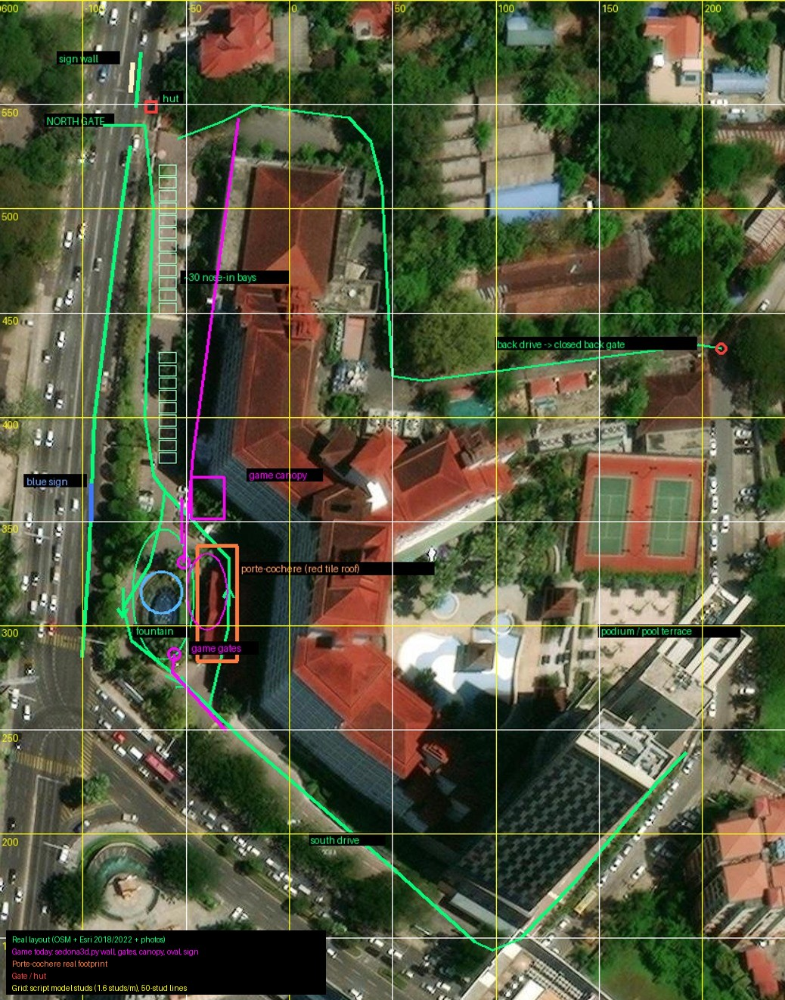
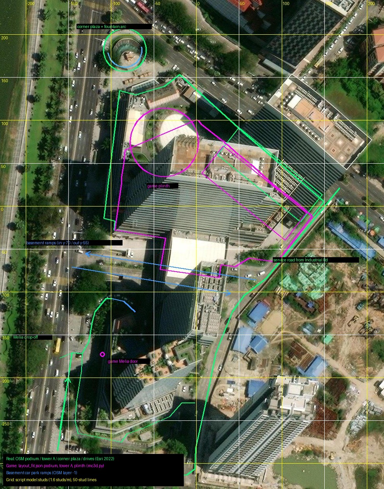

# Site audit: the game's Yangon landmarks against the real sites (2026-11-16)

Owner's complaint: "rn i see most places are wrong like for example: sedona car parking, entrance and everything & design".
This file covers each modelled landmark site: the real layout, what the script builds, and the fixes. Nothing in the game scripts was changed.

**How it was checked.** Each site was compared against the following sources:
- Esri imagery: the live tiles and two Esri Wayback captures, release 7110 (Nov 2022, short shadows, the clearest) and release 18820 (Oct 2018, the other lean).
- OpenStreetMap, from the API 0.6 map call: driveways, one-way tags, gates, `layer=-1` ramps.
- Street photos already in `refs/sedona/`, Wikimedia Commons photos, and hotel or listing pages.

Captures can be about 5 m apart in registration, and tall blocks lean: a roof shows offset from its base. Ground features were therefore judged in both captures.

**Coordinates.** The script frame is the one `sedona3d.py` and `mc3d.py` use: model x = world X - 32600 and model y = -(world Z + 1350). Both are in studs at today's 1.6 studs a metre (x east, y north). `landmarks.py` works in world studs. Sizes are in metres too, and key points have lat/lon so they carry over to the 3 studs/m rebuild. At 3 studs/m the model frame moves, so re-derive it from lat/lon.

**Colours.** Colours come only from midday or bright-haze photos, through `look/look_bible.json` and the research note "Myanmar Plaza and Sedona real look". Pass any new sample through `look_calib.py` first.

**One root cause behind most site errors at Sedona and Myanmar Centre.** The game's roads are wider than the real ones, and both scripts clip the real lot to the space the game's roads leave:
- `sedona3d.py` slides its entrance loop 22 studs east (`shift`).
- `landmark_mc_fit.py` cut 30% of the Myanmar Plaza podium, shifted tower A, and moved the corner plaza 117 studs.

That road ground in front of both buildings is where the real forecourts, car parks, gates and drop-offs are. The 3 studs/m rebuild with real road widths is the place to put them back. Until then, the fixes below give the real positions.

## Summary

| Site | Errors | Worst |
|---|---|---|
| Sedona Hotel | 22 | West forecourt (drive, ~30-bay car park, wall line) missing; two invented gates on the loop and the real north gate missing; porte-cochère 50 studs (31 m) too far north and the wrong shape |
| Myanmar Centre (Myanmar Plaza, Melia) | 12 | Podium cut by 30%, corner plaza 117 studs (73 m) off; no basement ramps, no Melia drop-off, no service road |
| Shwedagon | 14 | Site not turned 17°; platform is an octagon 134 studs too wide; stairway tops 20-82 studs off |
| Maha Wizaya | 16 | Stupa base square and 35 m instead of an octagon of 54 m; porches 23 studs too far in |
| Sule | 10 | Gate halls on the diagonals instead of N/E/S/W; shop ring 1 storey instead of 2 |
| City Hall | 9 | Courtyard roofed over; 4 floors instead of 3; flat grey roof instead of hipped |
| Independence Monument / Maha Bandula Park | 8 | Pillars stand free and are half height; the park layout is missing |
| Botataung | 12 | Platform over the road; redented square instead of an octagon; gates on the wrong side |
| Karaweik | 11 | Hulls too far apart; three halls instead of one palace; gangway missing |
| Chaukhtatgyi | 10 | Probably faces the wrong way (unconfirmed); figure 20 studs long; hall walls and roof colour wrong |
| Kaba Aye | 10 | Raised pentagon instead of a round flat platform; round base building missing; bell twice as wide |
| Game venues (`Config.YangonVenues`) | 11 | Every venue stands on real houses, forest or a construction site (an invented-content decision) |
| **Total** | **145** | |

## Sedona Hotel Yangon (`tools/yangon/city/sedona3d.py`)

**Sources.** The sources are in `sedona/` (copies of `sat/wb7110`, `sat/wb18820` and `osm_map.xml`) and `../sedona/`. They are:
- OSM ways: the one-way loop 1206690868 / 617314196 / 1206690867, the forecourt drive 614375509, the north gate link 680856733, the north and back drive 380666049, the south drive 614375510 / 614371807, and the back gate node 12277329382 (`hampshire_gate`, access=no).
- Esri captures 2022-11 and 2018-10.
- KartaView street photos `kv_*`.
- A Business Traveller review: "Burmese pavilion-style entrance, a large water feature".
- Third-party listings for parking: 95 covered and 124 uncovered spaces, height limit in the covered part ([myanmartours.us](https://myanmartours.us/hotel/sedona-hotel-yangon), [Expedia](https://www.expedia.com/Yangon-Hotels-Sedona-Hotel-Yangon.h528682.Hotel-Information); not confirmed by the hotel).
- The 2015 trade reports: a "3-storey connector ... retail arcade and an elevated podium ... terrace with a swimming pool" ([hoteldesigns.net](https://hoteldesigns.net/industry-news/sedona-hotel-yangon-set-to-open-new-wing-in-late-2015/)).

**Frontages.** The site touches three streets:
- **Kabar Aye Pagoda Road** on the west.
- **No.1 Industrial Road (Sat Hmu 1)** on the south-west.
- **Maw Ya Waddy Street** on the south-east and east.

Inya Road is not a Sedona frontage: it runs about 1.5 km to the west. The "Inya Road frontage" questions below are answered for Industrial Road.

### The settled questions

1. **Main entrance and exit: one vehicle gate on Kabar Aye Pagoda Road, used both ways.**
   - It is the north gate at model (-76, 532..548), lat/lon 16.83069, 96.15480: an opening about 16 studs (10 m) wide in the wall line.
   - On the road in front of it a yellow keep-clear box is painted across the kerb lane.
   - Arriving cars come from the northbound carriageway. That is the Sedona side, because traffic drives on the right.
   - OSM has no other vehicle opening on Kabar Aye Pagoda Road. The loop round the fountain has no gate of its own.
   - The photo `kv_kabaaye_north_gate_sun` shows a second, smaller gated opening about 30-40 m further north. It probably belongs to the neighbouring lot (unconfirmed).
   - There is also a back gate on Maw Ya Waddy Street at (209, 433). It is closed to cars (OSM access=no).
   - A third access probably serves the Inya Wing: the south drive round the tower meets Maw Ya Waddy Street near its mouth on Industrial Road, at about (100, 145) to (192, 239). This is from OSM; I could not see a gate.
   - So there is one gate for guests, not two.
2. **Guest parking.**
   - About 124 uncovered bays. The main row runs along the west forecourt: one row of nose-in bays, 2.5 x 5 m (4 x 8 studs), on the east side of the forecourt drive, x -62..-54, y 375..520. That is about 30 bays, in groups between trees.
   - About 6 cars park parallel on the outer (west) edge of the loop's west leg, x -86..-82, y 290..335.
   - The rest of the uncovered bays are along the south drive and the north / back drive (not counted bay by bay).
   - The 95 covered bays are in the 3-storey connector podium under the pool terrace. Its car entrance was not identified in the imagery.
3. **The drive loop.**
   - It is a one-way loop, anticlockwise seen from above, about 7 m (11 studs) wide, round an island about 19 x 39 m (30 x 62 studs) centred at (-61, 315). This is the island centre; the fountain basin's centre is (-62, 316).
   - The legs: the west leg runs south at x ≈ -80, the south arc runs east, the east leg runs north at x ≈ -30 under the porte-cochère, and the north arc runs back west to (-60, 364).
   - Cars enter it at its north-west corner from the forecourt drive, which comes from the north gate. They leave the same way, or by the south drive at its south-east corner (-39, 261).
   - The island is lawn and palms, with a round blue-tiled fountain basin about 12.5 m across (r 10 studs) at (-62, 316).
4. **The porte-cochère.**
   - A long canopy with a red-brown clay-tile hip roof stands over the loop's east leg, so drop-off is on the passenger (right) side, at the lobby.
   - Footprint x -45..-25, y 283..338: about 12 x 34 m, long axis north-south, centre lat/lon 16.82939, 96.15505.
   - It reads as a 1.5-storey pavilion ("Burmese pavilion-style"): white columns along the drive edge, dark eaves.
   - Roof colour as seen from the street (115, 90, 92); from above in sun (138, 94, 71); eaves (57, 59, 64).
5. **The Kabar Aye Pagoda Road frontage.** Outward from the building:
   - The wall line runs (-100, 285) → (-97, 330) → (-94, 400) → (-84, 480) → (-77, 530).
   - Outside it, a pavement about 3 m wide, then the red-and-white kerb.
   - The wall is a white rendered plinth about 0.6 m high, with white square pillars about 0.45 m wide and 1.9 m tall, about every 2.5 m. Between the pillars are white vertical picket railings, and a coil of razor wire sits above part of the run (`kv_kabaaye_wall_railing`, `_razorwire`).
   - Inside the wall: a strip about 6-10 m wide of big trees and shrubs, the forecourt drive and its parking row, then the loop and fountain.
   - The blue SEDONA board on two posts stands in that strip facing the road. In the 2020 photo it is level with the central pavilion, at about (-96, 350..368). The position is probable.
   - At the gate:
     - Big white pillars with stepped, tiered caps.
     - Red-and-white folding barriers.
     - A small sentry box with a red tile roof at the opening, about (-67, 549).
     - The cream sign wall with the SEDONA letters just north of the gate, along the wall line at about (-76, 556..570).
     - A clipped hedge by the gate.
6. **The Industrial Road frontage** (the one the brief calls "Inya Road").
   - From the road inward: the main carriageway, a hedged median, a parallel lane with parked cars (probable: `kv_industrial_inya_sw`), then the same white pillar-and-railing fence behind a row of big rain trees.
   - Inside the fence, the south drive runs along the Garden Wing's south arm and round the Inya Wing's south corner.
7. **How the Garden Wing and Inya Wing join; the courtyard and pool.**
   - The Garden Wing's south arm ends at the tower's north-west face (OSM: the arm's end (71.7, 206.6)-(94.2, 236.0) touches the tower's north-west side). The two blocks touch there.
   - The 3-storey connector podium fills the courtyard's south part, between the south arm, the east arm, the tower and the tennis courts. It holds the retail arcade and the covered car park.
   - On top of the podium is the pool terrace: the free-form main pool, the round children's pool or jacuzzi at (85, 317), and a palm-planted paved terrace (x 130..195, y 280..330).
   - The tennis courts (two, side by side east-west, each long north-south) sit at ground level east of the podium.
   - `sedona3d.py`'s deck (hull minus buildings) is a fair match for this.

### Errors and fixes (sedona3d.py)

1. **The compound wall is in the wrong place.**
   - Today `runs` puts the wall at x -56..-25, between 2 and 30 studs from the building. The real line is (-100, 285) → (-97, 330) → (-94, 400) → (-84, 480) → (-77, 530): 25-45 studs (16-28 m) further west.
   - Fix: build the fence from that polyline, not from `site.buffer(-1.5)`.
   - At 1.6 studs/m this needs the game's Kabar Aye Pagoda Road kerb pulled back to its real line, about x -100..-80. At the 3 studs/m rebuild, use the real kerb.
2. **The whole west forecourt is missing** (drive, parking, trees): it lies under today's game road and wall.
   - Fix: add the forecourt drive, 10 studs (6.5 m) wide, along (-90, 540) → (-70, 540) → (-66, 500) → (-68, 450) → (-70, 400) → (-66, 372) → (-60, 364). It is two-way, asphalt `DRV`.
3. **The car park is missing.**
   - Fix: about 30 nose-in bays, 4 x 8 studs (2.5 x 5 m), on the drive's east side, x -62..-54, y 376..520, in runs of 4-6 with a tree between runs.
   - Paint white bay lines, 0.15 m wide.
   - Add parallel bays along the outside of the loop's west leg, x -86..-82, y 290..335.
4. **Two invented gates.** The openings at (-55.6, 286.5) and (-51.5, 330.5), each with tiered pillars, barriers and a sign wall, do not exist: the loop is closed off from the road.
   - Fix: delete them. In the code, the loop's `drive` buffer must not cut the fence.
5. **The real north gate is missing.**
   - The fence code only covers y 240..540 and never meets the forecourt drive, so the photographed gate is not built.
   - Fix: at x ≈ -76, y 532..548 build:
     - The opening.
     - The tiered pillars, the existing `tiered_pillar` with w 2.4 and h 5.2, either side.
     - Barriers in the opening.
     - The red-tile sentry box at (-67, 549), 2.5 x 2.5 m.
     - The cream sign wall, the existing `CRM` 10 x 1.2 x 4.6 with SEDONA letters, along the wall north of the gate at (-76, 556..570), facing west.
     - The yellow keep-clear box on the road.
6. **The loop is in the wrong place.** `shift` = 22 moves it 22 studs (14 m) east.
   - Fix: `shift = 0` once the road no longer covers it. Real centre: (-55, 313).
7. **The island is the wrong design.**
   - Today: a hedge oval 20 x 36 studs (12.5 x 22.5 m) at (-40, 316).
   - Real: a lawn island of about 30 x 62 studs (19 x 39 m) at (-61, 315), with a round fountain basin of r 10 studs at (-62, 316) and palms.
   - Fix:
     - `oval = ellipse(-61, 315, 15, 31)`.
     - A basin ring `PGR` 0.6 m high at r 10.
     - Water `WAT` at 0.4 m.
     - A central spout.
     - 4-6 palms.
     - Drop the `HDG` ellipse.
8. **The porte-cochère is in the wrong place and has the wrong shape.**
   - Today `can` is a flat, dark (`TER`) slab 16 x 20 studs at x -47.5..-31.5, y 351..371, on 2 columns.
   - Real: about 12 x 34 m (20 x 55 studs) at x -45..-25, y 283..338. That is 50 studs (31 m) further south and 2.75 times longer.
   - Fix:
     - `can = [(-45, 283), (-25, 283), (-25, 338), (-45, 338)]`.
     - `hip_roof(can, 13.5, 0.5, 1.5, roof_grp="RTL")`, using the roof colours above.
     - White `SED` columns every 11 studs along x -44.
     - A lit soffit.
   - It must cover the loop's east leg at x ≈ -30.
9. **The loop is connected to nothing.** It needs links at its north-west corner (the forecourt drive) and its south-east corner (the south drive).
   - Fix: add `614375509` and `614375510` / `614371807` to `drive`, without the shift.
   - Add 3-4 painted one-way arrows, anticlockwise.
10. **The south drive is missing.**
    - Fix: (-38.9, 260.9) → (-23.6, 246.2) → (46, 187.1) → (89.4, 148.5) → (98.5, 144) → (111.8, 149.5) → (138.3, 177.1) → (177.9, 224.6) → (191.9, 238.9), 9 studs wide.
11. **The north drive, the back drive and the closed back gate are missing.**
    - Fix: (-54, 534) → (-17, 550) → (29, 544) → (44.6, 511) → (47, 466) → (50, 420) → (64.5, 418) → (198, 435). At (209, 433) put a closed steel gate on Maw Ya Waddy Street.
12. **The service yard is lawn.** Today grass covers the plant and chiller yard east of the north block (x 15..50, y 415..530).
    - Fix: grey concrete there, and a few plant boxes.
13. **Lawn on the neighbour's land.**
    - `site` (LOT ∩ box) reaches x 50..213, y 435..545. Beyond the back drive that is the neighbouring compound (sheds, a long red-roofed building), not Sedona (probable).
    - Fix: limit `site` to south of the back drive there (y < 430 for x > 50).
14. **The wall is the wrong design.**
    - Today: a solid 3.4-stud (2.1 m) white wall, a coping, pillars every 9 studs, and a continuous clipped hedge inside.
    - Real: a 0.6 m plinth, white square pillars 0.45 m wide and 1.9 m tall about every 2.5 m (4 studs), white vertical picket railings between them (see-through), razor wire on part of the run, and trees inside (no continuous hedge).
    - Colours: wall white (236, 237, 232) in bright haze.
15. **Most of the fence is missing.** Industrial Road has no fence today (`fence` keeps only x < -15).
    - Fix: run the same railing fence along the Industrial Road frontage, behind rain trees.
16. **The Maw Ya Waddy Street frontage has no wall.**
    - Fix: the podium's street wall, about 9 m, cream, with a screen of brown vertical metal fins (`kv_back_street_podium_*`).
    - Add the parked-car kerb on the street.
17. **No trees on the whole site.**
    - Fix:
      - About 12 big rain trees in the Kabar Aye Pagoda Road strip (x -95..-80, y 290..540).
      - About 10 along the Industrial Road fence.
      - Palms in the island and on the pool terrace.
      - Trees between the parking runs.
18. **The tennis courts are turned 90°.**
    - `T[0]→T[1]` runs north-south, so the courts come out stacked north-south, each long east-west.
    - Real: two courts side by side east-west, each long north-south. The surround's position is right, within 2 studs.
    - Fix: split along `e2`, not `e1`. Courts are 10.97 x 23.77 m plus run-off; green courts, red-brown surround.
19. **The sign board is in the wrong place and the wrong size.**
    - Today: 22 x 7 studs (14 x 4.4 m) at (-52, 350), on the loop's lawn.
    - Real: about 9 x 3 m on two posts, in the strip behind the road wall at about (-96, 359), facing west (probable).
20. **The covered car park is missing.** The 95-bay covered car park in the podium (with its height limit) has no entrance or opening.
    - Fix: leave a dark vehicle opening in the podium's street wall on Maw Ya Waddy Street (position unconfirmed: check a street photo first).
21. **The pavilion's canopy is placed by the old logic.** The canopy is placed from `wx`/`cyj` (the pavilion's west face, y 361). Deleting it fixes the "flat slab on two posts" look the owner sees from the road.
22. **No kerbs or footpaths inside the site.**
    - Fix: red-and-white kerbs on the island and the drive edges (as at the gate), and a 2 m paved footpath from the porte-cochère to the gate.

Lat/lon for the rebuild:

| Point | Lat, lon |
|---|---|
| North gate | 16.830686, 96.154804 |
| Sentry box | 16.830737, 96.154857 |
| Sign wall | 16.830816, 96.154804 |
| Fountain | 16.829420, 96.154886 |
| Porte-cochère centre | 16.829389, 96.155045 |
| Blue board | 16.829663, 96.154687 |
| Back gate | 16.830081, 96.156476 |

## Myanmar Centre: Myanmar Plaza, the Melia, The Lake Suites (`tools/yangon/city/mc3d.py`, `landmark_mc_fit.py`)

**Sources.**
- OSM, from the API map call in `myanmar_centre/osm_map.xml`:
  - Myanmar Plaza 421632377 and the Melia 463189671.
  - Basement service roads 614375512 / 614375513 (layer -1, one-way) and ramps 937729846 / 937729847.
  - The Melia drive 614375507 (one-way), 614375514 / 508 / 511.
  - The service roads 614371800, 614375515 / 516 / 517.
  - Bus stops.
- Esri 2022-11 and 2018-10 captures.
- `layout.json` (the real fit) against `layout_fit.json` (what `mc3d.py` builds).

**The site.**
- It touches two streets: Kabar Aye Pagoda Road (west) and No.1 Industrial Road (north-east).
- The corner plaza sits at their junction, opposite Sedona.
- The mall's north side faces Industrial Road and its west side faces Kabar Aye Pagoda Road.

### Real layout (model frame, studs)

- **Podium.**
  - The OSM outline (`layout.json` `podium`) runs x -108.6..149.7 and y -83.3..153.5, 37,330 square studs.
  - The north (Industrial Road) face steps from (-90, 135) to (-19.8, 153.5) and on to (58.9, 82.6).
  - The west face on Kabar Aye Pagoda Road is x ≈ -108..-90.
- **Corner plaza.**
  - A round paved plaza of r ≈ 25 studs (16 m) at (-84, 182), lat/lon 16.82866, 96.15476.
  - On its junction side (north), a curved teal water channel and a planter wall on an arc of r ≈ 20 studs, about 180°.
  - A sculpture in the middle; bench planters and paving to the south, toward the mall's corner entrance.
- **Basement car park.**
  - Entered from Kabar Aye Pagoda Road in the gap between the podium and the Melia.
  - The way in is one-way eastbound at y ≈ -69..-72, from (-146, -71), lat/lon 16.82723, 96.15439.
  - The way out is one-way westbound at y ≈ -51..-58, to (-143, -51).
  - Both run under the podium (layer -1) to its east end at (56, -104) / (82, -84). There they meet the service road from Industrial Road: (168, 21) → (82, -84) → (56, -104).
- **Melia drop-off.**
  - A one-way slip lane off northbound Kabar Aye Pagoda Road starts at (-163, -285) and runs to (-146, -171).
  - The drive then runs along the Melia's west face at x ≈ -134..-119 from y -172 to -123, curves east to (-99, -108), and goes down a ramp (layer -1) at (-92..-72, -108..-123).
- **Service drives.**
  - Round the Melia's south side: (-160, -177) → (-142, -251) → (-131, -266) → (-88, -275) → (-31, -245) → (-2, -229).
  - Down its east side to the south boundary: (56, -104) → (23, -171) → (-1, -282) → (-11, -313) → (-119, -301).
- **Bus stops.**
  - Two YBS stops "Industrial 1 / Myanmar Plaza" at (-140, -109) and (-178, -107).
  - "Myanmar Plaza Bus Stop" at (-109, 137).

### Errors and fixes

1. **30% of the podium is missing.** `layout_fit.json` keeps 70% of the podium (26,218 of 37,331 square studs). Compared with the real outline:
   - The north edge stops at y ≈ 100 instead of 153.5, so 53 studs (33 m) of the mall on the Industrial Road side are missing.
   - The west face is 13 studs (8 m) east of the real x -108.6.
   - The east end is 14 studs short.
   - Fix: build `layout.json`'s `podium`, not the fitted one. At 1.6 studs/m this needs the game's Kabar Aye Pagoda Road and Industrial Road kerbs at their real lines; at the 3 studs/m rebuild, use real widths.
2. **Tower A is shifted.** `A_shift` -27.92 moves the CB Bank tower 28 studs (17 m) south-west.
   - Fix: use `layout.json` `A` [(49.7, 91.4), (147.1, 13.3), (122.0, -18.5), (24.6, 59.6)].
3. **The corner plaza is in the wrong place.**
   - Today `plinth_c` is (-37.65, 74.36), which is on top of the real mall's footprint.
   - Real: (-84, 182). That is 117 studs (73 m) off.
   - Fix: `plinth_c = (-84, 182)`.
4. **The corner plaza is the wrong size and shape.**
   - Today: an arc wall of r 40 studs (25 m) over 104°.
   - Real: a round plaza of r ≈ 25 studs with a water channel and planter wall on an arc of r ≈ 20 over about 180°, a sculpture in the middle, and benches to the south.
   - Fix:
     - `plinth_r = 20`.
     - `plinth_span = 180`.
     - A 1.2 m `WAT` channel inside the arc.
     - A 16 m round paved disc.
     - A central sculpture plinth (2 x 2 m).
   - Keep the MYANMAR CENTRE letters on the arc (photo-sourced in the earlier pass).
5. **The basement car park ramps are missing.** There are no ramps, so the mall has no car park entrance at all.
   - Fix: two one-way ramps between the podium and the Melia, from Kabar Aye Pagoda Road. Each is 7 m (11 studs) wide, dropping 3.5 m over 30 m:
     - In: (-146, -71) → (-110, -76).
     - Out: (-110, -55) → (-143, -51).
   - The portals are dark openings under a concrete slab, with a height-limit bar and barriers.
   - Mirror them at the east end at (56, -104) / (82, -84).
6. **The Melia drop-off is missing.**
   - Today the canopy at the street door (y -172.5) opens straight onto the pavement.
   - Fix:
     - The slip lane (-163, -285) → (-146, -171), one-way northbound, 6.5 m wide.
     - The drive along x ≈ -128, y -172 → -123, curving east to (-99, -108).
     - The ramp down at (-92..-72, -108..-123).
   - The canopy must then sit over that drive, not over the pavement.
7. **The service road from Industrial Road is missing**: (168, 21) → (82, -84) → (56, -104), 7 m wide.
8. **The drives round the Melia's south and east sides are missing** (OSM 614375515 / 516 / 517): asphalt, 6 m wide.
9. **The bus stops on Kabar Aye Pagoda Road are missing**: shelters at (-140, -109) and (-178, -107), and the Myanmar Plaza stop at (-109, 137).
10. **The corner entrance is misplaced.** The corner front and its canopy (`ENTR[0]`) are placed on the cut podium's longest north-facing edge, so they stand about 40-55 studs south-east of the real corner entrance, which faces the plaza at about (-60..-20, 140..155). They follow once fix 1 is made.
11. **The west entrance canopy is misplaced** (`ENTR[1]`). It sits on the fitted west face, 13 studs east of the real face, and so overhangs the real pavement line.
12. **The paving is clipped.** `paving` comes from the clipped lot, so the plaza paving between the mall and the junction is missing. It returns with fix 3.

Not checked in this pass: The Lake Suites (`E`) footprint. In 2018 it was still a building site, and it leans strongly in the 2022 capture, so check it against a new capture.

## Shwedagon Pagoda

Sources: Esri Wayback z19 captures 2022-11 (release 7110) and 2018-10 (18820) in `sat/`, the OSM extract (`build/osm_ygn`), midday photos in `refs/catalogue/shwedagon`. All positions are world studs at the map's 1.6 studs/m (`geo.world`). "Local (u, v)" = metres-free offsets in studs from the stupa axis in the site's own frame, turned 17 deg (u = east', v = south'): world = (31636 + u cos17 + v sin17, 3830 - u sin17 + v cos17).

### Real layout
- **Stupa axis:** (31636, 3830). OSM plinth centroid (31637, 3831): the code's centre is right.
- **Orientation:** the whole complex is turned **17 deg anticlockwise** on the map (north axis leans to the west). The plinth's rectangle is at 17.1 deg, the platform at 16.5 deg, the stairways at 10 to 16 deg.
- **Plinth:** a redented square, 175 x 178 studs at 1.6 (110 m). The octagonal terraces are 98 studs (61 m) across.
- **Low wall round the plinth:** about 1 m high, a rounded square about 95 studs (59 m) from the axis. That is about 6 m outside the plinth, just outside the ring of small pagodas (OSM walls 117455415 and 1554351426-8).
- **Platform:** a rectangle with square corners, 336 x 437 studs (210 x 273 m), turned 17 deg. In local coordinates it runs u -159..+177, v -270..+167. Its world corners are NW (31404, 3614), NE (31730, 3524), SE (31853, 3939) and SW (31533, 4036). The stupa sits 51 studs south and 9 studs east of the platform's middle.
- **North stairway:**
  - Top (31584, 3565); foot and gate (31553, 3390) on Arzani Street, 177 studs long.
  - The covered roof is 42 studs (26 m) wide.
  - This is the only stairway off the axis: its top is at u +28.
  - A dark water tank stands beside the foot at X 31510-31535, Z 3364-3397.
  - A separate covered walkway with a lift, the "Northern Elevator Walk Way", runs at X 31467-31501, Z 3467-3589.
- **South stairway:** top (31683, 3988), foot (31769, 4299), 323 studs long. The roof is 36 studs (22.5 m) wide. The gate with the two giant chinthe faces the junction of U Htaung Bo Road, Shwedagon Pagoda Road and Arzani Street.
- **West stairway:** top (31482, 3878), foot (31191, 3948), 299 studs long. The roof is 25 studs (16 m) wide. The gate stands on a turning circle off U Wisara Road (the service road "Entrance to Pagoda"). A pair of chinthe there is probable.
- **East stairway:**
  - Top (31803, 3770), foot (32129, 3725) on Gyartawya Street, 329 studs long.
  - It crosses Arzani Street at about (31990, 3758). The roof breaks there; probably the street crosses at grade between two flights.
  - The roof is 49 studs (31 m) wide, with shops on both sides.
- **Buildings on and by the platform:**
  - Naungdawgyi Pagoda: a gold stupa at (31673, 3608), local (100, -202), base about 30 studs (19 m) across.
  - Sacred Hair Relic Washing Well: a white octagon at (31570, 3709), 14 studs (9 m) across.
  - Halls fill the north zone in rows and line the east and west edges.
  - A large green-roofed hall complex stands just past the SE corner, round (31700-31850, 3930-4060).
  - Maha Buddhavamsa Museum: a large grey roof under the west edge, X 31375-31450, Z 3700-3810.
  - Board of Trustees office: (31776, 3993).
- **Roofs:** in both captures almost every hall roof on the platform is dark green or teal tiled, with gilded spires. Only one red roof shows, at about (31560, 3678).
- **Trees on the platform (probable):** big crowns stand at about (31533, 3864), (31734, 3803), (31661, 3931) and (31661, 3657), with more along the NW corner (31435, 3614) and the east edge. Dense forest covers the hill below the platform on every side.
- **Car parks (all at the foot of the hill):**
  - NW: X 31368-31509, Z 3409-3519 (OSM 444334693).
  - East: X 31940-32028, Z 3825-4004 (OSM 407462471).
  - South-east: X 31797-31939, Z 4098-4214 (OSM 444461997).
  - West: a small one at about (31269, 3877).
- **Drives:** a service drive climbs from U Htaung Bo Road to the SE side, (31827, 4288) -> (31851, 4094) -> (31994, 4143). There is the turning circle at the west gate, and a drive through the NW car park to the north gate.
- **No moat.** The nearest water is Thway Say Lake to the north (about Z 3260) and the tank by the north gate.

### Errors and fixes
1. **Wrong orientation: 0 deg in the code, 17 deg in reality.**
   - At the platform corners the code is up to 130 studs off. Every stairway top is off as well (see 3).
   - Fix: add `yaw=math.radians(17)` to `SHW`. Rotate every local offset with `rot(x, z) = (x*cos(yaw) + z*sin(yaw), -x*sin(yaw) + z*cos(yaw))` before adding `cx, cz`: the platform `P8`, the walkway quads, the band, the hall spots, the hall ring, the inner ring, the 64 + 4 pagoda spots and the collision boxes (their yaw argument).
   - Pass the same yaw to the stupa's `prism` and `lathe` and to the `redent` and `ngon` polygons (rotate their points).
   - Check the sign once: the north stairway must still end at world (31553, 3390).
2. **Wrong platform shape and size.**
   - The code builds an axis-aligned octagon 470 x 500 studs (294 x 312 m) with 72-stud chamfers. The real platform is a 336 x 437-stud rectangle (210 x 273 m) with square corners.
   - So the code is 134 studs (84 m) too wide east-west and 63 studs (39 m) too short north-south.
   - The code's NE and SW chamfer areas hang over forest. Its west edge (X 31401) covers the Buddhavamsa museum, which is about 50 studs west of the real edge at that height.
   - Fix (local frame, used with the yaw): `plat=(-159.0, -270.0, 177.0, 167.0, 6.0)`. The collision boxes follow from `plat`. At the coming 3 studs/m scale: (-298, -506, 332, 313).
3. **Stairway tops misplaced.** The feet match OSM to within 1 stud. Fix in `SHW['stairs']` (same format, unrotated world offsets from the centre; keep the feet):
   - S top: 59 studs off. Real (31683, 3988). Change `(62.5, 215.0)` to **`(47.0, 158.0)`**. The length becomes 323 studs (code: 264).
   - N top: 20 studs off. Real (31584, 3565). Change `(-55.5, -285.0)` to **`(-52.0, -265.0)`**. Length 177 studs.
   - E top: 69 studs off. Real (31803, 3770). Change `(235.0, -50.5)` to **`(167.0, -60.0)`**. Length 329 studs.
   - W top: 82 studs off. Real (31482, 3878). Change `(-235.0, 63.5)` to **`(-154.0, 48.0)`**. Length 299 studs.
   - If the platform is drawn in the turned frame, the tops land on its edge: local N (28, -270), S (-1, 167), E (177, -9), W (-159, 1).
4. **Stairway widths too narrow** (OSM roof outlines; they probably include the stalls under the roof).
   - Current `W` values: S 26, N 22, E 22, W 22.
   - Real: S 36 studs (22.5 m), N 42 (26 m), E 49 (31 m), W 25 (16 m). At 3 studs/m: 68, 79, 92, 47.
   - Fix: set these `W` values. If the shops should read separately, use a 22-stud covered stair plus side stalls.
5. **East stairway runs straight over Arzani Street.**
   - The single ramp passes about (31990, 3758) at about y 73. Its ramp and parapet collision probably cut the street.
   - Fix: build two stairways, upper (31803, 3770) -> (31975, 3762) and lower (32005, 3753) -> (32129, 3725). Leave a 30-stud gap at the street level (srtm_y there), and put a gate on each side of the street.
6. **Plinth and stupa drawn 42% too big against the map.**
   - The plinth is 54 m half-width x SH 2.3 = 248 studs; the real plinth on the map is 175 studs (+73).
   - With the correct platform this leaves 44 studs between the plinth and the east and west edges; the real gap is 81.
   - The metres are right: OSM gives 110 m, the code 108 m.
   - Fix: on the 1.6 map use `SH=1.6` for everything with a footprint (plinth and terraces 173 studs) and keep SV 3 for height. If the owner wants the stupa to look bigger, keep SH no higher than 1.9 (plinth 205 studs) and accept a narrower walk.
   - At the coming 3 studs/m scale: `SH=3.0`, plinth 324 studs, platform 630 x 820 studs.
7. **Ring round the plinth: wrong place and probably wrong design.**
   - The code paints a dark red band (150, 62, 52) from 146 to 164 studs off the axis.
   - Reality is a low wall about 1 m high at about 95 studs (59 m) from the axis, just outside the small pagodas. Neither capture shows a red band on the floor (probable).
   - Fix: replace the band with a wall 0.6 m thick and 3 studs (1 m at SV 3) high, on a redented square of half-width `SH*59` (95 studs at SH 1.6; 177 at 3 studs/m), turned with the yaw.
8. **Missing Naungdawgyi Pagoda.** It is the platform's largest secondary stupa, but the code has only random pagodas.
   - Fix: add `zedi(H, b)` at world (31673, 3608), local (100, -202). The base is 19 m across: 30 studs at 1.6, 57 at 3 studs/m.
   - The height is not measured. Probably about 30 m: 90 studs at SV 3.
   - Keep the random halls and pavilions 25 studs clear of it.
9. **Missing Sacred Hair Relic Washing Well:** a white octagon at (31570, 3709), 9 m across (14 studs at 1.6, 27 at 3), low parapet. Keep the inner ring's pavilions off it.
10. **Hall layout and roofs do not match.**
    - The code spreads random halls along all 8 octagon edges, including the chamfers, which do not exist. Reality: rows of halls fill the north zone (local v -270 to -110), a continuous row lines the east and west edges, and the south side is open with the stairway hall.
    - Roofs: the code uses `ROOF_RED` for the 4 cardinal halls and a 30% chance of a red roof on ring halls. The satellite shows dark green or teal roofs almost everywhere (1 red roof in about 40).
    - Fix: put the cardinal halls on `ROOF_GREEN`; set `red_roof = rng.random() < 0.05`. Pick hall spots along the 4 straight edges of the new rectangle, plus 2-3 north-south rows in the north zone.
    - The cardinal halls' wall colour (200, 46, 38) is not supported by the photos, which show gilded and white fronts. Probable fix: walls gilded `GOLD_V` with white trim. Check against a midday photo of a cardinal shrine before changing.
11. **Missing trees on the platform (probable):** about 6-8 large crowns at roughly (31533, 3864), (31734, 3803), (31661, 3931), (31661, 3657), (31435, 3614) and along the east edge, each 10-15 m across (16-24 studs at 1.6).
12. **Missing around the foot of the hill.** `landmarks.py` builds none of these; check whether the street or green layer has them before adding.
    - The 4 car parks: NW X 31368-31509, Z 3409-3519; E X 31940-32028, Z 3825-4004; SE X 31797-31939, Z 4098-4214; W at (31269, 3877).
    - The SE service drive from U Htaung Bo Road: (31827, 4288) -> (31851, 4094) -> (31994, 4143).
    - The west gate's turning circle off U Wisara Road.
    - The north lift walkway at X 31467-31501, Z 3467-3589.
    - The water tank by the north gate.
13. **Chinthe only at the south gate.** A pair at the west gate is probable from the OSM steps and landing shape there, but I have no photo to confirm it. Fix only after a photo: `chinthes=(key in ('S', 'W'))`.
14. **Colours: no change made.** The stupa's GOLD (246, 176, 52) Metal agrees with the photos.
    - The two catalogue photos are not usable for exact values: one was taken at 09:14, the other is a 13:10 HDR with a warm tone.
    - The teal walkways (`MARBLE_TEAL`) are not visible in either capture (probable error); the floor reads near-white marble.
    - For exact values, measure a true midday photo with `look_calib.py`.

Folder: `shwedagon/` (section.md, annotated image, downloads).

## Maha Wizaya Pagoda

Sources: Esri Wayback z19 captures 2022-11 and 2018-10 (in `shwedagon/sat/`), the OSM extract, and the photos in `refs/catalogue/maha_wizaya`. Only one photo is a true midday shot (2013, 12:49, overcast). All positions are world studs at 1.6 studs/m. The site is square to the map: OSM's square edges run within 0.3 deg of north.

### Real layout
- **Axis:** (32083.5, 4435.5). The code's (32083, 4436) is right.
- **Terrace (paved courtyard):** a square 147 x 147 studs (92 m), X 32010-32157, Z 4362-4509 (OSM temple 160698623). It is raised; the steps on each side suggest probably 2-4 m.
- **Stupa base:** a gilded octagon (chamfered square) of redented tiers, 87 studs (54 m) across, X 32041-32128, Z 4392-4478 (OSM 180612556, matches both captures).
- **Bell:** a broad bell sitting straight on the low base tiers. Then come a ringed cone of about 8 rings, the banana bud, a large horizontal glassy disc under the bud (about 0.45 of the bell's width) and the hti with its vane.
  - The bell is probably 20-25 m across. On photos the height above the bell's base is 1.7-2.1 times the bell's width.
  - The total height is not confirmed. The facts give 40 m; one web source gives 117.5 ft (35.8 m), but in a Kaba Aye article, so it may be Kaba Aye's figure.
- **Four entrance porches** stand on the terrace edge, open to the outside. They are 21 x 20 studs (13 m) and project 10 studs past the edge: N (32084, 4363), S (32082.5, 4508), W (32010, 4435), E (32156, 4435.5).
  - Photos show cream walls with gilded arched frames and ornate gables.
  - Green tiled roofs show in the 2013 photo and the captures.
- **Four corner shrines:** about 16-stud squares turned 45 deg, centred at +-63 from the axis: (32021, 4372.5), (32147, 4373.5), (32019.5, 4499), (32145, 4498.5). In both captures they show a dark green roof with a gold finial (probable).
- **Inner walkway:** an octagon at +-54 round the base (OSM 1553315826). It was painted maroon in 2018 and is grey in 2022.
- **Steps and approaches:**
  - N: steps (32084, 4342 -> 4353), then a footpath north to U Htaung Bo Road, (32085, 4313) -> (32070, 4261).
  - S: steps (32082, 4519 -> 4559) to the south drive.
  - E: steps (32166 -> 32212, 4436) to the east drive.
  - W: steps (31920, 4446) -> (31999, 4435), reached by a footbridge (31849, 4465) -> (31912, 4448) from Shwedagon Pagoda Road across the Fish & Turtle pond.
- **Drive loop (service road):**
  - From U Htaung Bo Road / Shwedagon Pagoda Road at (31886, 4345), east along the north side (Z 4310-4345) to (32170, 4345).
  - Down the east side at X 32210-32212 to (32207, 4558).
  - West along a one-way pair at Z 4559 / 4569 to the SW gate (31894, 4589).
- **Two ceremonial arch gates** on Shwedagon Pagoda Road: NW (31884, 4345) and SW (31893, 4595). Photo: a cream arch with gold relief, a green iron fence and red-and-white kerbs.
- **Water:** no moat. The only water is the Fish & Turtle pond west of the site, X 31841-31921, Z 4412-4505, walled.
- **Bodhi-tree platform:** a white paved octagon, X 32157-32202, Z 4511-4555 (45 studs, 28 m), with a tree in the middle at (32179, 4533).
- **Car parks:** S X 32038-32063, Z 4572-4580; SE X 32161-32201, Z 4575-4601.
- **Green:** lawns on the W and SE sides of the terrace and woodland to the NE (OSM grass 1554004494-6, forest 1554004493). Big trees stand south of the south drive.
- **Interior:** the stupa is hollow with a shrine room inside (travel sources). Under the owner's interiors rule it could be made walkable once photos are gathered.

### Errors and fixes
1. **Stupa base is the wrong shape and size.**
   - The code uses Shwedagon's square redented tiers: `base_k 0.8` gives half `54*0.404*2.4*0.8` = 42 studs, so the base is 84 studs at SH 2.4 (35 m).
   - The real base is an octagon of 87 studs at 1.6 (54 m): 19 m too small in metres.
   - Fix: give `stupa()` octagonal tiers for the base only (`octa=True` is all-octagon now; add a flag that applies it only to tiers 0-3). Set the base half to 27 m. With `Hm=40`, `k=0.404`, `w = 27/(0.404*54)`, so `base_k = 1.24`.
   - At SH 1.6 the base is 87 studs; at 3 studs/m, 163.
2. **The stupa's form is Shwedagon's, not Maha Wizaya's.**
   - The code stacks 5 octagonal terraces and a slim bell on Shwedagon's profile. Maha Wizaya has a low base (about 3 tiers), a broad bulbous bell set straight on it, about 8 cone rings, a bud and a big glassy disc under the bud.
   - Fix: write a `wizaya_profile()` (metres; r, h): base tiers 0-8 m, bell from r 11-12.5 m at 8 m up to r about 9 m at 22 m, cone 22-32 m (r 6 -> 2.5, 8 rings), bud 32-37 m, hti 37-40 m.
   - Add the disc: a thin ring at about 33 m, r about 5.5 m (0.45 of the bell's width), `GOLD` rim plus a glassy centre.
   - The bell's width (20-25 m against the code's 17 m) is probable, not measured. Check it against a photo with a known scale before changing `bell_k` (1.12 -> about 1.4).
3. **Terrace is too small and has a made-up second step.**
   - The code builds `rect(70,70)` (140 studs) plus an upper `rect(63,63)` (126 studs). The real courtyard is one level, 147 studs (92 m): 7 studs too small, 21 for the upper step.
   - Fix: `rect(73.5, 73.5)` for the slab and `col.add(..., 147, 4, 147)`. Drop the 126-stud upper step. If a lip is wanted, use 145 studs.
   - At 3 studs/m the courtyard is 276 studs.
4. **Entrance porches misplaced, facing the wrong way and too small.**
   - The code puts them at +-50 from the axis, 18 x 12 studs, facing inward. They belong on the terrace edge at +-73: 23 studs out.
   - Fix:
     - `hx, hz = cx + ux*73, cz + uz*73`
     - `yaw = yaw_to(ux, uz)` (open to the outside steps)
     - `hall(10.5, 10.0, 13.0)`: 21 x 20 studs, 13 m; 39 x 38 studs at 3 studs/m.
   - Colours: cream walls instead of WHITE, and gilded frames instead of RED columns. Probable values from the photos: wall about (207, 173, 133) and gilt about (170, 116, 49), both from the 2001 photo with no time. Run them through `look_calib.py`.
   - The roof is probably a green-tiled gable (ROOF_GREEN with gold trim). The 5-tier pyatthat on every porch is unconfirmed: the 2013 photo shows one tall red-and-gold pyatthat near one porch. Keep it on one porch at most until a photo shows which.
5. **Corner shrines misplaced and wrong design.**
   - The code puts gold `zedi(26, 4.4)` at +-56. The real shrines are at +-63.5: 7.5 studs out on each axis, 10.6 along the diagonal.
   - Fix: `cx + sx*63.5, cz + sz*63.5`. Each is a 16-stud square shrine turned 45 deg, with a green tiled roof and a gold finial (probable from both captures). At 3 studs/m: +-119, 30 studs square.
6. **Railings on the wrong line, probably the wrong colour.**
   - The posts stand at +-68, inside the slab edge; the terrace edge is at +-73.5.
   - Fix: `x, z = 73*c - t*s, 73*s + t*c`, with `t` over -72..72.
   - Colour: the photos show a pale grey or white balustrade on the courtyard edge, not teal (60, 150, 130) (probable). The teal green iron fence belongs on the road side by the gates.
7. **Grass pad buries the north drive and the Bodhi platform.**
   - `rect(110,110)` covers X 31973-32193, Z 4326-4546. It covers the north drive (Z 4318-4345 between X 32030 and 32170) and most of the Bodhi octagon.
   - Fix: pad X 32000-32200, Z 4350-4552, with the Bodhi octagon cut out. Better: use the OSM grass polygons 1554004494, 1554004495 and 1554004496 and the forest polygon 1554004493 as separate pads.
8. **Missing inner walkway:** a paved octagon ring at +-54 round the base, 4 studs wide; maroon in 2018, grey in 2022 (use a darker marble).
9. **Missing steps.** The courtyard is reached only by collision.
   - Add `_steps` runs: N (32084, 4342 -> 4353), S (32082, 4519 -> 4559), E (32166 -> 32212, 4436), W (31920 -> 31999, 4440), each about 12 studs wide (OSM porch width).
10. **Missing drive loop and car parks.**
    - Drive loop: north side (31886, 4345) -> (32003, 4310) -> (32084, 4342) -> (32170, 4345); east side X 32211 from Z 4345 to 4558; south one-way pair at Z 4559 and 4569, back west to (31894, 4589). It is a single lane, probably about 5 m wide (8 studs).
    - Car parks: S X 32038-32063, Z 4572-4580; SE X 32161-32201, Z 4575-4601.
    - Build them in the street layer if it does not already have them.
11. **Missing west approach:** the Fish & Turtle pond (X 31841-31921, Z 4412-4505, walled) with the footbridge (31849, 4465) -> (31912, 4448) and the W steps. The docstring's "moat with a bridge from the north" is wrong: there is no moat. Fix the docstring.
12. **Missing gates:** two ceremonial arches on Shwedagon Pagoda Road, NW (31884, 4345) and SW (31893, 4595), about 4 x 15 studs in plan. Cream with gold relief, a green iron fence either side.
13. **Missing Bodhi-tree platform:** a white octagon of 45 studs (28 m) centred at (32179, 4533), a low step, a big tree in the middle.
14. **Mixed scales.** The terrace is at the map's 1.6 but the stupa is at SH 2.4.
    - With fix 1 at SH 2.4 the base would be 130 studs, nearly filling the 147-stud courtyard. Real: 87 of 147.
    - Fix: footprint SH = 1.6 on the current map; everything at 3.0 after the rescale.
15. **Colours:** use only the 2013 midday photo (overcast).
    - Its raw medians are bell (175, 148, 102) and gilded terrace (102, 81, 43). Pass them through `look_calib.py` before use.
    - The GOLD material itself is fine.
    - The hall WHITE + RED combination is wrong (see 4).
16. **Optional, interior:** the real stupa is hollow and visitors go inside. If photos of the inside are gathered, the solid stupa collision (tiers 0-4) can become a walkable hall with doors at the 4 porches.

Folder: `maha_wizaya/` (section.md, annotated image, downloads).

## Sule Pagoda

Builder: `sule()` in `tools/yangon/city/landmarks.py`. Sources: OSM (API 0.6 map call, `osm_map.xml` here), Esri Wayback 7110 (Nov 2022) and 18820 (Oct 2018) z19 mosaics (`sat7110.jpg`, `sat18820.jpg`; the two agree within about 3 studs here), Commons photos `p1.jpg` (sunny, midday: "Temple as Roundabout") and `p2.jpg`, Wikipedia (44.13 m, octagonal). World studs are the map frame (1.6 studs a metre across). Sizes are given in metres, at 1.6 and at the stupa's SH 2.3 where it matters. At the planned 3 studs a metre, multiply metres by 3.

### Real layout

- **Compound** (OSM way 131745510, satellite agrees): a rounded ring, nearly a circle flattened N-S. Centre (33199.7, 8063.4). Extent X 33124..33275 (151 studs = 94 m) by Z 7995..8132 (137 studs = 86 m). Area 5,940 m². The outer face is a continuous shop front on the roundabout's pavement.
- **Stupa base** (OSM 477836654): an octagon about 37 m across (59 studs at 1.6, 85 at SH 2.3), centre **(33199.6, 8070.3)**. OSM puts its corners within about 8° of N, E, S and W. Hand-mapped, low confidence. 44.13 m tall.
- **Four entrance halls on the compass points** (OSM buildings, each with a `highway=steps` climbing from the street to the platform). Each is a passage straight through the shop ring:
  - **N:** centre (33201.7, 8015.3), X 33191..33212 by Z 7995..8035. 13 m wide by 25 m deep (21 x 40 studs).
  - **S:** centre (33198.5, 8118.2), X 33188..33209 by Z 8104..8132. 13 m by 17 m (21 x 28 studs).
  - **W:** centre (33144.7, 8069.2), X 33124..33165 by Z 8061..8077. 26 m by 10 m (41 x 16 studs).
  - **E:** centre (33254.6, 8071.4), X 33233..33275 by Z 8064..8079. 26 m by 9 m (42 x 15 studs).
- **Shop ring:** four quadrant blocks (OSM 481432186 NW, 481432185 NE, 481432193 SW, 481432194 SE), 16-19 m deep, between the outer face and an inner edge about 45-50 studs from the centre.
  - The NW and NE blocks hold shrine halls with tall tiered gold-and-green pyatthat roofs. Photo `p2` shows three in one view, at roughly (33165, 8030) and (33235, 8030), ±10 studs.
  - Roofs are green-teal sheet (satellite (77, 110, 100) in sun, (52, 81, 64) in shade).
- **Ring look** (photo `p1`, midday):
  - Two storeys, about 9 m to the top of the gold eave frieze, with gold gable finials above.
  - Ground floor: shopfronts with mixed signboards on pale yellow walls (216, 210, 157).
  - A dark maroon band at the first-floor line.
  - Upper floor: white-grey walls (197, 202, 200) with blue balcony railings (34, 91, 136) and white gabled bays.
  - A continuous gold frieze and gables all round.
  - There are no blue awnings in the photos.
- **Inner courtyard:** a white paved walkway about 10 m wide round the stupa (satellite (249, 237, 225)), at platform level, about one storey above the street.
- **Roundabout:** the carriageway ring (OSM "Sule Roundabout" ways) has its centreline about 85-95 studs from the centre. Sule Pagoda Road comes in from N and S, Maha Bandula Road from E and W.

### Errors and fixes

1. **The gates are on the diagonals, not on N/E/S/W.**
   - What's wrong: `gate = i % 2 == 0` with `Po = ngon(..., 8, pi/8)` puts the four gate halls and their 56-stud pyatthats on the faces at 45°, 135°, 225° and 315°: (33247, 8113), (33153, 8113), (33153, 8019), (33247, 8019).
   - How far off: 45°, about 51 studs (32 m) along the ring from each real gate.
   - Fix: change it to `gate = i % 2 == 1`. Faces 1, 3, 5 and 7 are S, W, N and E.
2. **The gate halls are the wrong shape and in the wrong place.**
   - What's wrong: each is a 16 x 12 hall that stands *outside* the ring face (radius 67).
   - Real: each is a passage through the ring from the street to the courtyard, with stairs.
   - Fix: give each a body of 13 m across (21 studs) by the OSM depth (N 40, S 28, W 42, E 42 studs), centred on the OSM centres above. Put a stair rising 4.3 m (13 studs SV) inside it. Put the tiered gold roof on top of the passage.
3. **The ring's outline is too small and the wrong shape.**
   - What's wrong: it is a regular octagon with apothem 66, 132 studs across both ways.
   - Real: 151 studs E-W by 137 studs N-S, and rounded. E-W is 19 studs (12 m) short in total, N-S 5 studs short.
   - Fix: build the outer face on OSM 131745510's 36 points, or on an ellipse with half-axes 75.5 (E-W) and 68.5 (N-S) centred (33199.7, 8063.4). At 3 studs a metre that is 283 x 257 studs.
4. **The ring is too low and has one storey instead of two.**
   - What's wrong: `h = 12`, which is 4 m at SV 3.
   - Real: about 9 m to the frieze top, plus gables of about 1.5 m. Too low by about 5 m (15 studs).
   - Fix: `h = 27` (SV 3). Ground floor 0..12 studs, maroon band 12..13, upper floor 13..22, gold frieze 22..27, gable finials to about 31.
5. **The ring's design is wrong.**
   - What's wrong: dark doorways, blue sloped awnings, plain white sign boards and a brick-red flat roof terrace.
   - Fix: use the colours listed in the real layout.
     - Ground floor: pale yellow walls (216, 210, 157) with lit shopfronts and mixed small signs.
     - Maroon band at the first-floor line.
     - Upper floor: white-grey (197, 202, 200), with a blue rail line (34, 91, 136) along each bay.
     - A gold frieze with a gable every 8-10 m.
     - Green-teal pitched roof sheets (77, 110, 100).
   - Run the photo colours through `city/look_calib.py`; the samples are from one sunny photo, ±15.
6. **The inner courtyard is missing.**
   - What's wrong: the ring's inner apothem is 34 and the stupa plinth's apothem is 34.2 (`2.3 * 44/99 * 54 * 0.62`), so the stupa fills the inner terrace.
   - Real: the inner edge is at about 46 studs, which leaves a walkway about 10 m wide.
   - Fix: `ri = 46` at 1.6. Keep the stupa's lowest tier at an apothem of 34 at most, so a 12-stud walkway stays. Floor colour white (249, 237, 225).
7. **The stupa base is too small for its own scale, and its corners may be turned.**
   - Size:
     - The lowest tier is 68.5 studs across at SH 2.3, which is 29.8 m. Real is 37 m (OSM), so it is 7 m (20%) small.
     - At SH 2.3 the true size would be `base_k` of about 0.77 (an apothem of 42.5 studs), but that cannot fit the 1.6-scale ring (whose inner edge is at 46). Leave 0.62 until the rescale.
     - At 3 studs a metre: base 111 studs across, compound 283 studs.
     - Note: Wikipedia's "each side 24 ft (7.3 m)" fits the upper octagon (17.6 m across), not the base.
   - Orientation:
     - The code turns it by pi/8 (faces to N/E/S/W). OSM has corners about 8° from the compass points.
     - Low confidence: confirm from an aerial or face-on photo before changing it.
     - If OSM is right, use `rot` 0 in the `octa` branch.
8. **The centre is 4 studs north.**
   - What's wrong: `cz = 8066` against the OSM stupa centroid at 8070.3 (2.7 m north). X is right (0.4 studs).
   - Fix: `cx, cz = 33199.6, 8070.3`. The ring stays on the compound centre (33199.7, 8063.4), so the stupa sits 7 studs south of the ring's middle, as it does in reality.
9. **The tiered shrine halls in the NW and NE blocks are missing.**
   - What's wrong: the skyline in photos shows two or three tall gold-and-green pyatthats besides the stupa.
   - Fix: add 7-tier pyatthats, about 20 m (60 studs SV), at about (33165, 8030) and (33235, 8030). Positions ±10 studs, medium confidence. Use gold roofs with green tier panels.
10. **Height and platform level:** correct. 44 m stupa; the platform is at gy + 13 (4.3 m), which matches the stairs climbing one storey. No change.

Error count: **9** (item 10 is a check, not an error).

Image: [sule_annotated.jpg](sule/sule_annotated.jpg). In it, green is the real layout (OSM + satellite), magenta is the game's ring, stupa plinth, pad and gate spots, and cyan is the roundabout.

Folder: `sule/` (section.md, annotated image, downloads).

## Yangon City Hall

Builder: `city_hall()` in `tools/yangon/city/landmarks.py`. It is drawn straight in world studs at 1.6, from the OSM outline. Sources: OSM relation 5677100 (outer 131745508, inner courtyard 381280249; `sule/osm_map.xml`), Esri Wayback 7110 / 18820 (`sule/sat*.jpg`), Commons photos `p1.jpg` (south front from Maha Bandula Park, sunny) and `p2.jpg` (the SW corner from the Sule roundabout, sunny), and Wikipedia (1926-36; floor count 3).

### Real layout

- **Outline** (OSM outer = the code's `pts`, identical): X 33258..33451 (193 studs = 121 m) by Z 7881..8021 (140 studs = 87.5 m). It is a closed ring of wings round an **inner courtyard** (OSM inner): X 33291..33426 by Z 7912..7984, 135 x 72 studs (84 x 45 m), 3,236 m².
  - In 2022 the courtyard is a lawn with trees (satellite (128, 142, 87)), with a lower central block on its south side (Z about 7960-7995).
- **Front:** south, on Maha Bandula Road (the road's centreline is at Z 8080-8091). The middle bay projects to Z 8021 (X 33337..33390). The main entrance is at about (33363, 8021).
- **SW corner:** chamfered, from (33258, 7981) to (33287, 8008), facing the Sule roundabout. It has a corner entrance and a tall white tiered tower (photo `p2`).
- **Forecourt** between the front and Maha Bandula Road, Z 8021..8076 (about 34 m deep):
  - a car park;
  - a planted strip at Z 8035..8055;
  - a fence with white posts along the road pavement (photos);
  - a white canopy at about (33360, 8030) in 2022.
- **Roads round it:** Sule Pagoda Road to the W (X about 33245), Maha Bandula Park Street to the E (X about 33455-33470), Municipal Street to the N (Z 7870).
- **Building:**
  - 3 storeys. Wikipedia and the photos agree; OSM's `building:levels=4` is the outlier.
  - About 17-18 m to the parapet, ±2 m (estimated from the photos, not measured).
  - White walls and arched ground-floor windows, with pale blue-grey / teal trims.
  - Hipped light-grey roofs (satellite 2022 (207, 204, 199)) with teal eave bands (120, 164, 144). The 2016 photo `p2` shows a red-orange roof edge, so the roof was probably repainted; trust the 2022 capture.
  - White tiered pyatthat towers with small gold tips:
    - a large central one over the south entrance, set back: its roof block in the 2022 capture centres at about (33363, 7985), ±10;
    - one at the SW chamfer;
    - smaller ones at the ends of the south front.

### Errors and fixes

1. **The courtyard is roofed over.**
   - What's wrong: `fan(...)` covers the whole outline (including the 3,236 m² courtyard) with a flat roof, and walls are only drawn on the outer ring. From above, City Hall reads as one solid block.
   - Fix: walls on the inner polygon too (OSM 381280249's 16 points, normals pointing into the courtyard). Roof only the ring (outer minus inner; triangulate it with shapely, as `geom3d` already does for caps with holes). Courtyard ground: grass (128, 142, 87) with 6-8 trees. The collision box can stay a single box.
2. **Too many floors.**
   - What's wrong: four window rows (`gy+2..9, 14..19, 23..28, 32..37`) and `H = 42` (14 m).
   - Real: 3 storeys, about 17-18 m.
   - Fix: three rows:
     - tall arched ground floor about 6 m (18 studs SV);
     - first and second floors about 5 m each (15 studs);
     - parapet about 1.5 m (4.5 studs).
   - So `H` is about 52 studs. Uncertain by ±6 studs: check against a face-on photo before building.
3. **Wrong roof form and colour.**
   - What's wrong: a flat grey roof (150, 146, 140).
   - Real: hipped roofs along each wing, light grey (207, 204, 199), with a teal eave band (120, 164, 144).
   - Fix: a hip over each wing, rising about 3 m (9 studs SV) from the parapet line, with a teal band 0.8 studs high at the eave.
4. **The central tower may be too far forward.**
   - What's wrong: it is on the front bay at (33363.5, 8006).
   - The 2022 capture shows the tower's square roof block centred at about (33363, 7985). That is about 20 studs (13 m) further back, on the main block behind the entrance bay.
   - Medium-low confidence, because Esri leans tall roofs east, not north.
   - Fix: move `fzc - 6` to about 7988, and keep the projecting entrance bay (X 33337..33390, Z 8008..8021) at the parapet height.
5. **Two side pyatthats overhang the wall.**
   - What's wrong: those at (33314, 8012) and (33413, 8016) stand 4 studs in front of the facade line (Z 8008 and 8012 there). Their 16-stud base boxes overhang it by about 12 studs.
   - Fix: z = 8000 and 8004 (half a base box inside the wall).
6. **Two pyatthats can't be verified.**
   - What's wrong: the three-tier ones at the north corners (33268, 7886) and (33446, 7890) are not visible in either capture or in any photo found.
   - Fix: drop them, or confirm them from a north-side photo first. Low confidence either way.
7. **The SW chamfer tower is too small.**
   - What's wrong: the code puts 5 tiers, 34 studs tall, at (33268, 7990).
   - Real: photo `p2` shows the corner tower as one of the two tallest after the centre one.
   - Fix: 5-7 tiers, about 45 studs, centred on the chamfer's middle (33272, 7995), with the corner entrance below it facing SW (yaw towards Sule, direction (-0.68, -0.73)).
8. **The forecourt is missing.**
   - What's wrong: the pad is only the outline, so the ground from Z 8021 to Maha Bandula Road is whatever the city fill puts there.
   - Fix: a paved pad over the polygon (33285, 8022), (33452, 8022), (33452, 8076), (33300, 8076), (33285, 8050).
     - Car-park bays across it.
     - A planted strip at Z 8035..8055.
     - A white-post fence along Z 8076, with a gate on the entrance axis at X 33363.
9. **Colours:** close. The walls (238, 236, 228) match the white in the photos; the trim teal (120, 168, 160) is close to the satellite eave band (120, 164, 144). No change, apart from adding the roof colour (item 3).

Error count: **8**.

Image: [city_hall_annotated.jpg](city_hall/city_hall_annotated.jpg). In it, green is the real outline, courtyard, forecourt and entrances; magenta is the game's central bay, pyatthat spots and solid roof outline; cyan is the roads.

Folder: `city_hall/` (section.md, annotated image, downloads).

## Independence Monument (Maha Bandula Park)

Builder: `independence()` in `tools/yangon/city/landmarks.py`. It is drawn in world studs with no SH of its own; read its horizontal sizes as studs at 1.6, the map's scale.

Sources:
- OSM: park 129485365, monument circle 129485369, the paths, 3 gates and 2 fountain pools (`sule/osm_map.xml`).
- Esri Wayback 7110 (2022) and 18820 (2018).
- Commons photos `p1.jpg` (sunny, face-on) and `p2.jpg`.
- Wikipedia: park of 3.0 ha, remodelled 2012.

### Real layout

- **Park:** OSM fence line X 33208..33430 by Z 8155..8504 (222 x 349 studs = 139 x 218 m). Bounded by Maha Bandula Road (N), Sule Pagoda Road (W), Maha Bandula Park Street (E) and Konthe Road (S).
- **Gates:**
  - N (33329, 8156), facing City Hall, at the meeting point;
  - W (33213, 8293), on Sule Pagoda Road;
  - E (33427, 8295), on the park street.
- **Monument centre (33320.9, 8294.2)**, OSM circle 48 studs (30 m).
  - The paved round plaza is about 54 studs across (34 m), centre about (33323, 8291) in both captures.
  - A ring path of radius 19.5 studs (OSM 1221938483) runs round the podium.
- **Paths** (OSM, matching both captures):
  - N-S axis: X 33326 (N gate) to 33322 (plaza); south of the plaza it runs from 33319 to 33313, down to Z 8478.
  - E-W axis: Z 8293-8295, gate to gate.
  - A rectangular loop: X 33245..33413 by Z 8180..8355.
  - Cross path at Z 8237; southern paths at Z 8424, 8448 and 8478.
- **Water:**
  - Two rectangular pools either side of the N path: (33295.4, 8168.7), 36 x 17 studs (23 x 11 m); and (33366.1, 8170.6), 51 x 17 studs (32 x 11 m).
  - A small round fountain NW of the plaza at about (33276, 8256) (2022).
  - A pond with a footbridge in the wooded south half, at about (33375, 8445).
- **Lawns:** open lawns in the north half (2022 satellite (128, 142, 87)), with clipped topiary and a ring of small trees round the plaza.
- **South half:** wooded; playground at about (33240..33280, 8385).
- **Monument** (photo `p1`; the 46 m total sets the scale):
  - a podium of about 5 steps, about 2.4 m high and 13-14 m across;
  - a **round white drum** 6.7 m across and about 6 m tall (223, 222, 216), with **two gold bands** (210, 177, 47): one at its top, one about 2 m below;
  - the white shaft (194, 194, 196 in shade) to a sharp tip at 46 m;
  - **five slender pillars hugging the shaft's foot**: they start on the drum top (about 8.5 m up) and taper to points about 20 m above the ground;
  - chinthe statues on small plinths at the foot of the steps (five in view in `p1`).

### Errors and fixes

1. **The five pillars stand in the wrong place and are too short.**
   - What's wrong: they stand free on the base at radius 20 studs (12.5 m) and run from gy + 1.2 to gy + 30 (to about 10 m).
   - Real: they cling to the shaft, within the drum's 3.4 m radius, and run from about 8.5 m to 20 m.
   - Fix: radius 5.5 studs (3.5 m at 1.6); prism from gy + 25 to gy + 50, then a frustum to a point at gy + 60 (SV 3), with the gold ring dropped. Keep 5, at `-pi/2 + 2*pi*k/5`.
2. **The pedestal has the wrong shape.**
   - What's wrong: a square 13 x 13, 12 studs tall (4 m), with one gold band.
   - Real: a round drum about 6.7 m across, about 6 m tall, with two gold bands.
   - Fix: `prism(w, ngon(5.4, 24), ...)` (5.4 studs = 3.4 m at 1.6) from yb to yb + 18 (SV). Gold bands 0.9 studs tall at yb + 17.1..18 and yb + 11..11.9. The shaft starts at yb + 18.
3. **The base is a big three-step mound instead of a flat plaza with a small podium.**
   - What's wrong: three rings of radius 26, 21 and 16 studs, 3.6 studs high in all; the top ring is 20 m across.
   - Real: a flat paved plaza 34 m across, with a podium about 13-14 m across and 2.4 m high in the middle.
   - Fix:
     - a plaza disc of radius 27 at gy, paving (173, 176, 162);
     - a podium of 5 steps, radius 11 to 8.5 studs (0.5 stud less each step), each 1.44 studs high (0.48 m SV), 7.2 studs in all;
     - the pad `ngon(40, 16)` becomes 'pave' out to radius 27 and grass beyond.
4. **The chinthe count and placement are wrong.**
   - What's wrong: two chinthe, both facing south, at (±9, +22).
   - Real: chinthe on plinths ring the podium's foot, facing out along the paths.
   - Fix: at least one chinthe on each axis path, radius 13 studs, facing out (N, E, S, W), plus a pair either side of the N and S steps (±6 studs). The exact count isn't certain: check `Yangon, Independence Monument, Lions, Myanmar.jpg` on Commons.
5. **The shaft has the wrong section.**
   - What's wrong: a smooth square frustum.
   - Real: a ribbed, fluted shaft whose section looks pentagonal or star-like, with a sharp tip.
   - Fix: build the shaft from 5 ridges (a 10-point star polygon, inner radius 0.75 of the outer) on the same taper. That is a form detail; the size is fine (10.4 studs at the foot, about 4-5 m).
6. **No paved plaza:** the pad is grass everywhere. It is covered by fix 3.
7. **The park round the monument is missing**, unless another layer builds it (check `d20_green.py` / `details.py`). This builder makes only the monument and a grass disc of radius 40.
   - Missing:
     - the fence on the OSM outline;
     - the three gates at the coordinates above;
     - the paths listed above, about 3 m wide (5 studs);
     - the two pools at (33295.4, 8168.7) and (33366.1, 8170.6), sizes above, dark water (21, 33, 23);
     - the round fountain at (33276, 8256);
     - the south pond at about (33375, 8445);
     - the playground.
8. **Centre and height:** correct. (33321, 8294) = the OSM centroid (0 studs off); top at 46 m (138 studs SV).

Error count: **7** (item 8 is a check).

Image: [independence_annotated.jpg](independence/independence_annotated.jpg). In it, green is the real park fence, gates, monument circle, plaza and paths (dashed); cyan is the water; magenta is the game's base rings, pillars, chinthe and pad.

Folder: `independence/` (section.md, annotated image, downloads).

## Botataung Pagoda

Builder: `botataung()` in `tools/yangon/city/landmarks.py` (SH 2.3 for the stupa; the platform and shrines are in studs at 1.6).

Sources:
- OSM `osm_map.xml` here: compound 314136068, stupa 180605242, wall 395456382, pond 314136067, buildings, gates 3201820706 and 3983153303.
- Esri Wayback 7110 (2022) and 18820 (2018). In 2018 the dome sits about 8 studs east and the west hall was different.
- Commons photos `p1.jpg` (the gilded entrance) and `p2.jpg` (the stupa from the platform, sunny).
- Wikipedia: 40.13 m, hollow, base 29 m square.

### Real layout

- **Compound** (OSM 314136068): X 35352..35516 by Z 9006..9349 (164 x 343 studs = 103 x 214 m), long N-S.
  - N: Strand Road, with a compound wall at Z 9006-9008.
  - E: a fence on Botahtaung Pagoda Road (fence X about 35508-35516; road centreline X 35520-35532).
  - S: the jetty road (Z about 9342).
  - W: a service lane (X about 35340).
- **Gates:**
  - **main gate with ticket office on the E side, (35509, 9118)**, opposite the stupa;
  - N gate on Strand Road at (35449, 9007), opening onto a walk between two halls.
- **Stupa** (OSM): an octagon with its corners due N, E, S and W, centre **(35455.6, 9115.6)**. 46 studs corner to corner (29 m), 42.5 studs flat to flat. 40.13 m tall.
  - Photo `p2`: low rounded polygonal terraces, then a bell. The bell's widest point is about 0.65-0.72 of the lowest terrace's width (from the photo, perspective not corrected).
- **Four gilded porches into the hollow stupa**, on the compass points against the base:
  - N about (35456, 9086), S about (35456, 9147), W about (35427, 9115), each about 20 x 16 studs;
  - E is OSM 314136046: X 35478..35508 by Z 9104..9127 (19 x 14 m), running out to the main gate.
- **Paved octagonal ring** round the stupa (2022 capture; edges ±5 studs): about 88 x 92 studs (55 x 58 m), centre (35449, 9121).
  - It carries a fence ring, with cream-yellow posts and mesh (photo `p2`).
  - It also carries 8 small planetary shrines: white-pink tiled cubes about 3 m (193, 184, 179), each with a gold zedi top, 6-8 m in all.
- **North halls**, red roofs (satellite (185, 93, 75), (99, 67, 51) in shade):
  - X 35368..35440 by Z 9020..9058;
  - X 35460..35514 by Z 9021..9054.
- **Long west hall:** OSM 314136060, X 35392..35420 by Z 9074..9181.
- **Turtle pond** with a pavilion, SE of the stupa: OSM 314136067, X 35460..35503 by Z 9177..9215.
- **Open paved square** to the south: about X 35385..35505 by Z 9215..9270. Trees and pavilions (green roofs) lie south of it, and the jetty is at the south end.
- **Floor:** white glazed tiles (satellite (249, 243, 232); photo, which is the true colour, (183, 176, 154)).

### Errors and fixes

1. **The platform pokes into the road and over the north halls.**
   - What's wrong: the platform is 140 x 160 (X 35386..35526, Z 9036..9196). It passes the east fence (X about 35508) by 18 studs (11 m), into Botahtaung Pagoda Road's pavement and west lane. Its north edge (9036) runs 22 studs into the north halls (to Z 9058).
   - Fix: replace it with the paved octagonal ring `plat_poly((-44, -46, 44, 46, 26))` centred (35449, 9121), raised 1.5 studs (0.5 m SV), and lay flat white paving over the OSM compound polygon at gy.
2. **The ground pad covers the road.**
   - What's wrong: `plat_poly((-90, -100, 90, 100, 30))` reaches X 35546, 30 studs over the road (it covers its west half), and Z 9016..9216 (the north halls and the pond).
   - Fix: make the pad the OSM compound polygon (314136068), clipped at X ≤ 35508.
3. **The terraces are square instead of octagonal.**
   - What's wrong: tiers 0-3 of `ZEDI_TIERS` are `sq` and `square=True`, so the code makes redented squares.
   - Real: OSM is an octagon with its corners on N/E/S/W, and the photo shows rounded polygonal terraces.
   - Fix: give `stupa()` a flag `octa_base`: for tiers 0-3 use `ngon(ra / cos(pi/8), 8, 0.0)` (corners on the compass points), and keep the bell round (segs 36). The new flag stops `octa` from making the bell octagonal too.
4. **The plinth is 7% small.**
   - What's wrong: 62 studs across at SH 2.3 = 27 m. Real is 29 m (OSM and Wikipedia).
   - Fix: `base_k` 0.62 → 0.667 (67 studs at SH 2.3; 46 at 1.6; 87 at 3 studs a metre).
5. **The bell is too wide.**
   - What's wrong: with `bell_k = 1.25` the bell's widest point (24.4 x 1.25 profile metres) is 0.91 of the lowest tier.
   - Real: the photo gives about 0.65-0.72.
   - Fix: `bell_k` about 0.95-1.0 (medium confidence: one photo, from close).
6. **The shrines round the stupa are wrong.**
   - What's wrong: 10 shrines alternate on an ellipse of radius 58 (x) by 66 (z): 5 zedis 18-26 studs tall and 5 halls with 26-stud pyatthats.
   - Real: 4 gilded porches attached to the base on N/E/S/W, plus 8 small planetary shrines on the octagonal ring.
   - Fix:
     - Porches: `hall(8, 10, 12)` with a gold interior, yaw facing out, at (35456, 9086), (35493, 9116), (35456, 9147) and (35427, 9116). These are at 1.6; their faces come from photo `p1`.
     - Planetary shrines: 8 small ones at radius 40 studs, on angles k·45° from the centre (35449, 9121). Each is a 4-stud tiled cube (193, 184, 179) with a gold `zedi(14, 2.2)` on top.
     - Drop the 5 pyatthat halls.
7. **The north halls are missing:** two red-roof halls, X 35368..35440 by Z 9020..9058 and X 35460..35514 by Z 9021..9054, about 1.5 storeys with a hipped red roof (185, 93, 75).
8. **The west hall is missing:** OSM 314136060, X 35392..35420 by Z 9074..9181, a long red-roof hall.
9. **The gates are missing:** the main gate (pyatthat gateway) on the E fence at (35509, 9118), facing the road; the N gate in the Strand Road wall at (35449, 9007). The wall and fence lie along the compound outline.
10. **The turtle pond and the south square are missing:** the pond on OSM 314136067 (X 35460..35503, Z 9177..9215) with a pavilion over its west half; the white paved square at about X 35385..35505 by Z 9215..9270.
11. **The floor colour is too grey and dark.**
    - What's wrong: STONE / MARBLE (196, 190, 178) / (206, 202, 194).
    - Real: white glazed tiles, photo (183, 176, 154) in sun; the satellite shows near-white.
    - Fix: SmoothPlastic about (232, 230, 224) with a little Reflectance, through `look_calib.py`.
12. **Centre and height:** correct. (35456, 9116) = the OSM centroid (0.4 studs off); 40 m stupa.

Error count: **11** (item 12 is a check).

Image: [botataung_annotated.jpg](botataung/botataung_annotated.jpg). In it, green is the real compound, stupa, halls, porches, paved ring and square, and gates; cyan is the roads and the pond; magenta is the game's platform, plinth (dashed), shrines and pad (dashed).

Folder: `botataung/` (section.md, annotated image, downloads).

## Karaweik Palace (`karaweik()`)

Sources: Esri Wayback 2022-11 (`sat_7110`) and live (`sat_live`) z19 mosaics, OSM way 117381678 (outline) + gangway / shore / car park ways (`osm.xml`), Wikipedia (floor 82 x 39 m, 2 storeys, 1974), midday Commons photos in `photos/` (k_restaurant_1230.jpg is 12:30). Positions are world studs on today's 1.6 studs/m map; metres in brackets for the 3 studs/m rebuild. The builder draws everything at SH = 1.6 across and SV = 3 up.

### Real layout
- Twin-hull barge, long axis 9.9 deg (OSM long edges; code 9.57 deg: fine), **bows with the two gold karaweik birds to the west, sterns east**. Centre about (34771, 4383) (code (34768, 4382): fine).
- Length bow tip to stern tip about 140 studs along the axis (87 m; OSM 34702 to 34840). Overall width about 71 studs (44 m) across both hulls incl. deck overhangs (Wikipedia floor 39 m).
- Each hull about 30 studs (19 m) wide; hull centrelines about 21 studs (13 m) either side of the axis: north hull through (34770, 4360), south hull through (34770, 4402). Open water between the two bows, about 12 studs wide, from the bow tips back to about X 34742; behind that one superstructure joins both hulls.
- Superstructure (photos): ONE continuous two-storey palace from just behind the birds (X ~34730) to the stern deck (X ~34825), rows of tiered green roofs with gold eaves and gables stepping up to one tall gold spire at mid-length (about (34772, 4380); it leans in the image). Deck about 5 m above water, eaves ~6 m and ~11 m above deck, spire base ~20 m, spire top ~38 m above water (scaled off photo 1; +-3 m).
- Birds: gold, body + S-neck at each bow, head top ~17 m above water. Stern: a tall flat red panel with a gold rim sweeping up to ~18 m above water at the east end of each hull (photos).
- Access: a gangway 66 x 8 studs (41 x 5 m), bearing 8 deg, from the stern deck between the hulls at (34800, 4387) to the shore gate at (34865, 4396) (OSM 907237794; in the image it has a tan-red roof, so probably covered: verify). Shore gate building 13 x 22 studs (8 x 14 m) round (34876, 4397) (OSM 1557971603). Car park + drive loop 120 x 110 studs east of it (OSM 1557971570, X 34879-35004, Z 4372-4484). Lakeside walk round the promontory (OSM 314121258). No jetties seen on the hulls' lake sides.
- Midday colours (photos 12:30 / 14:06): hull red (112, 35, 29) sunlit, (94, 19, 28) shade; birds and gold bands (226, 188, 66); roofs olive green (88, 105, 64) / blue-green (75, 94, 98); satellite roofs (92, 104, 76).

### Errors and fixes
1. **Hulls too narrow and too far apart.** Code hull centres at local x = +-30 (60 apart) with a max half-width 11 (22 wide); real centres +-21 (42 apart, 26 m) and about 30 wide (19 m). Overall width 82 vs 71 studs (11 too wide). Fix: `for sx in (-21.0, 21.0):` and `w = 12.6 * math.sin(...) ** 0.6 + 1.0` (max outer half-width 13.6 x 1.1 = 15 -> hull 30 studs; outer edges at +-36). Move the bird, breast, wings and tail with `sx` as now. At 3 studs/m: centres +-39, hull 57 wide.
2. **Superstructure is three separate blocks, real is one palace.** Code: hall 52 x 24 at z -24, hall 52 x 28 at z +30, square hall 32 x 32 at z +3 with a 9-tier spire. Real: one two-storey palace covering both hulls from local z -36 to +50 (X 34733-34818), x -36 to +36, with tiered green roofs rising in steps to the central spire. Fix: replace the `for zc, ...` loop and the middle hall with a first storey `hall(36.0, 43.0, 17.0, ...)` at z +7 (eave ~5.7 m above deck), a second storey `hall(26.0, 32.0, 15.0, ...)` on it (eave ~11 m above deck), each with `hipped(...)` roofs in ROOF_GREEN, small `pyatthat` roofs along both hulls (every ~14 studs from z -30 to +44 at x +-21), and keep the spire at z +3. Wrong form: no open deck between separate halls in reality.
3. **Spire base too low, spire too tall a share.** Real spire base ~25 m above water (75 studs), top ~38 m (114 studs); code base at wl+30 (10 m), top wl+122 (40.7 m), so the code's spire is 92 of the 122 studs while the real one is about a third of the height. Fix: `pyatthat(13.0, 7, 39.0)` placed at `wl + 75.0` (on top of the stepped roofs of fix 2) -> top wl + 114 (38 m). Tier count from the photos looks like 7 (verify).
4. **Deck too low.** Code hull top wl+10 (3.3 m); real deck ~5 m above water. Fix: hull band tops `wl + 15.0` (b at wl+11, c at wl+15) and lift the deck, halls and birds by +5 studs.
5. **Stern wrong shape and too low.** Code: a round tube curling 10 studs forward, top at wl+35 (11.7 m). Real: a flat upswept red panel with gold rim, top ~18 m above water. Fix: per hull a flat blade 1.6 studs thick from local z +44 to +66, its top edge rising to wl + 54 and curling forward at the tip, red (112, 35, 29), gold (226, 188, 66) rim strip.
6. **Gangway missing.** Fix (new in the builder, world studs): a deck 8 wide from (34800, 4387) to (34866, 4396) at deck height (wl + 15), handrails, a tan-red roof (154, 122, 77, satellite; verify with a photo), and leave an opening in the stern rail where it lands. 66 x 8 studs = 41 x 5 m.
7. **Shore gate, car park, lakeside walk missing** (outside the barge, but they are the arrival): gate building 13 x 22 studs at (34876, 4397); car park outline OSM 1557971570; walk OSM 314121258. Add as ground pads / props or hand them to the map layers.
8. **Hull colour too bright.** Code (150, 34, 28); photo (112, 35, 29) sunlit. Fix the two hull quads and the tail to (112, 35, 29) (run it through `look_calib.py` for the part colour).
9. **Roof green slightly off.** Code ROOF_GREEN (52, 104, 74) is bluer than the photo's olive (88, 105, 64); satellite (92, 104, 76). Fix: (84, 102, 68) for the palace roofs.
10. **Bow gap.** With fix 1 the deck box must stop behind the bows: real open water between the bows from the tips back to local z about -27 (X 34742). Fix: `box(mm, 0, deck, 11.5, 42.0, 1.2, 77.0, ...)` (z -27 to +50) instead of the 72-wide, 88-long box.
11. Small: real bow tips sit about 6-10 studs further west than the code's beaks in the 2022 image (the bird heads lean in the photo, so OSM's bow at X 34702 is the safer number; code beak at about X 34698: keep).

Image: [karaweik_annotated.jpg](karaweik/karaweik_annotated.jpg) (green = real, red = game, cyan = lakeside walk; grid 20 studs).

Folder: `karaweik/` (section.md, annotated image, downloads).

## Chaukhtatgyi Buddha Temple (`chaukhtatgyi()`)

Sources: Esri Wayback 2022-11 and live z19 mosaics, OSM (`osm.xml`: building 117384553, entrances 3201670863 main / 3201670460, covered walkways 314121266 / 314121271 / 314121274, parking node 3201670865), Commons photos in `../catalogue/chaukhtatgyi/` (10:02, indoor), thailex.info (65.85 m long, rebuilt 1973). World studs at 1.6 studs/m; metres in brackets. The builder draws everything at SH = 1.6 across, figure up at about 3 a metre.

### Real layout
- Shed: one big green multi-tier gable roof, long axis 32 deg (east-south-east; code 32.3 deg: right). The roof mass in both captures matches the code's 150 x 74 rectangle round (34072, 1474) to within about 5-8 studs; OSM's outline (cyan in the image) traces only part of it (main hall 135 x 35 studs + a NE wing), so don't take OSM's 22 m width.
- Entrances: MAIN on the north-east side near the south-east end at (34116, 1449), reached from the car park (open lot about X 34088-34180, Z 1398-1462, service road from the street to the north-east) and from a long covered walkway that runs along the whole NE side from (33806, 1246) to the main door (OSM 314121271, about 380 studs). A side door on the SW side at (34055, 1491), with a covered walkway from (33926, 1517) via (34009, 1568) and a path south to Shwe Gone Dine Road at (34059, 1632). Another covered walkway crosses the west, (34009, 1376) to (33875, 1595).
- Neighbours: monastery buildings close on every side; a white curved-roof hall just SW at about (34055, 1550); Shwe Gone Dine Road about 150 studs south (Z ~1620 at X 34060); Nga Htat Gyi across that road (facts json: about (34176, 1698), not checked here).
- Figure: 66 m (106 studs at 1.6). Orientation: one secondary source (via search, not confirmed on a primary page) says the head points east and the face looks north. On this 32 deg axis that means head at the SE end, face towards the NE, i.e. towards the main entrance and car park, which fits how visitors arrive. Treat as likely, verify with a 360 photo.
- Inside (photos, indoor shade, so real values are lighter): soles salmon red (160, 85, 54) with a gold grid of the 108 marks and a gold wheel in the middle, toes with gold spirals; face white (176, 175, 176) with big glass eyes, black liner, blue lids, red lips (103, 35, 39); robe a matte gold-ochre (146, 122, 76); gold jewelled crown; a gold spiked railing with lamps along the front of the dais; walls dark red corrugated sheet (68, 26, 30) under exposed steel trusses; ceiling white panels. Roof from the satellite: green (110, 140, 108).

### Errors and fixes
1. **Figure probably turned the wrong way round (180 deg).** Code: head at the NW end (local -x), face to the SW (local +z). Likely real: head SE, face NE. Fix: `yaw = yaw_to(-uz, ux) + math.pi` (the shed is symmetric, the dais then sits towards the SW side and the face looks at the main door). Uncertain: confirm before changing.
2. **Figure 20 studs too long.** Crown tip (local x -64) to soles (+62) = 126 studs (79 m); real 66 m = 106 studs. Fix: multiply every figure x centre and x radius by 0.84 (head centre -47 -> -39.5, soles 60.5 -> 50.8, crown lathe length 10 -> 8.4) and the dais `rect(58.0, 13.0)` -> `rect(49.0, 13.0)`. At 3 studs/m the figure is 198 studs long.
3. **Soles wrong colour and design.** Code: white soles (240, 236, 228) with three gold stripes. Real: salmon red soles with a gold square grid (108 squares in rows) and a central gold wheel. Fix: sole ellipsoids (200, 108, 76) (shade value lifted ~25%; calibrate with `look_calib.py`), replace the stripes with a 9 x 12 gold grid of thin quads plus a gold disc in the middle; toe tips gold spirals (a gold ring on each toe).
4. **Shed walls wrong.** Code: open sides with 9 steel columns a side, no walls. Real (photos): dark red corrugated sheet walls and gable ends above a low open band, steel trusses visible, white ceiling. Fix: red wall quads (120, 46, 44) from y gy+14 to the eaves (gy+36) on both long sides and the gable triangles, and a white ceiling (230, 230, 228) under each roof tier in place of the dark (70, 74, 78) underside.
5. **Roof colour.** Code ROOF (118, 128, 132) grey; satellite green (110, 140, 108) both captures. Fix ROOF = (104, 138, 104) (satellite colour, not a midday photo: confirm with an outside photo).
6. **Robe too metallic.** Code puts the robe in the GOLD mesh (Metal, glowing at night). Real robe reads as matte gold-ochre (146, 122, 76) in shade. Fix: move the robe ellipsoids to a MIX mesh with vertex colour about (200, 168, 104), keep only crown, trims and railing in GOLD.
7. **Gold railing missing.** Fix: a gold rail ~1.2 m (4 studs) high along the face side of the dais, local z +13 (after fix 1 it faces the main door), the dais' length, posts every 3 studs with small lamps.
8. **Main entrance and approaches missing.** Fix (world studs): a door opening in the NE wall at (34116, 1449) (about 8 studs wide, 5 m); the covered NE walkway (33806, 1246) -> (33959, 1344) -> (34009, 1376) -> (34113, 1442), about 8 studs wide (5 m, estimate) with a light green-grey roof (147, 165, 135 satellite); the SW door at (34055, 1491) with its covered walkway (33926, 1517) -> (34009, 1568) -> (34055, 1491) and the path to (34059, 1632); the car park lot X 34088-34180, Z 1398-1462 as a paved pad.
9. **Ground pad too big.** `rect(L/2 + 6, Wd/2 + 6)` (162 x 86) reaches over the walkway along the NE side and the neighbours. Fix: `rect(L/2 + 2, Wd/2 + 2)`.
10. Eyes: code dark ellipsoids only; real large glass eyes with a white ring, black liner and pale blue lids (face2 sample (170, 178, 189)). Fix: add a thin pale blue lid ellipsoid over each eye and a black liner arc.

Image: [chaukhtatgyi_annotated.jpg](chaukhtatgyi/chaukhtatgyi_annotated.jpg) (green = real, cyan dashed = OSM outline, red = game; grid 20 studs).

Folder: `chaukhtatgyi/` (section.md, annotated image, downloads).

## Kaba Aye Pagoda (`kaba_aye()`)

Sources: Esri Wayback 2022-11 (`sat_7110`) and live (`sat_live`) z19 mosaics, OSM (`osm.xml`: pagoda ring 186911800, ring road 615410293, east corridor 1274989981, trees), Commons midday photos in `../catalogue/kaba_aye/` (12:56-13:03), Wikipedia (34 m, five porches, hollow, Maha Pasana Cave to the north). World studs at 1.6 studs/m; metres in brackets. The builder draws the terrace at 1.6 and the stupa at SH = 2.6 across, SV = 3 up.

### Real layout
- A flat, ROUND platform paved in pale marble tiles, radius about 83 studs (52 m), centre (32471, -6514) (OSM ring), with low rim buildings; a ring road round it at radius ~90 (OSM 615410293).
- In the middle a round hollow building (the pagoda's own base, cave-temple style): roof ring radius about 22 studs (14 m) round (32469, -6519) (mean of the two captures), five arched porches with gilded tiered pediments reaching to radius ~28 (17.5 m); cream-white walls (230, 222, 197), gold frieze (192, 159, 107), pediments (206, 171, 108) (photo).
- The gold bell sits directly on that building, base radius about 12 studs (7.5 m) (satellite dome r 10-12; photo: bell about 0.4 of the building's width). Total 34 m (Wikipedia; it also gives 117 ft 6 in = 36 m). Gold (238, 222, 179) lit, (206, 177, 138) shade (photo).
- Five covered walkways (about 8 studs = 5 m wide, dark green roofs (86, 96, 79) from the satellite) run straight from the building's porches to gate porches with orange tiered roofs (215, 154, 105) on the rim. Directions (atan2(dZ, dX), Z south): 28, 92, 155, 236, 313 deg (+-5). They are not evenly 72 deg apart. A sixth link runs east from the NE porch, (32492, -6540) -> (32555, -6538), into a long covered corridor (about 15 studs wide) that leads ENE to the car park and Kaba Aye Pagoda Road at about (32720, -6585) (OSM 1274989981).
- Ground: no flights of steps seen round the platform rim in either capture (it is on the hill top; the ring road is lower, height unknown). Trees ring the platform outside the rim (OSM tree nodes).
- Maha Pasana Cave lies north (not in this builder; nearest big OSM hall 415127420 at about (32437, -6697), unverified).

### Errors and fixes
1. **Terrace wrong shape and too small.** Code: a pentagon of circumradius 62 (inradius 50) raised 10 studs. Real: a round platform radius 83 (52 m). Fix: `pent` -> `ngon(83.0, 48)`, the gold edge band on `scale2(ngon(83.0, 48), ...)`, collision `col.add(cx, y0 - 3.0, cz, 166, 6, 166, ...)`. At 3 studs/m: radius 156.
2. **Centre 8 studs too far south.** Code (32470, -6511); real drum centre (32469, -6519), platform centre (32471, -6514). Fix: `cx, cz = 32469.0, -6518.0`.
3. **The round building is missing.** Code puts stupa terraces straight on the terrace. Real: a round hollow building radius 22 (14 m) with five porches out to radius 28, the bell on its roof. Fix: `prism(mix, ngon(22.0, 40), cx, cz, y0, y0 + 30.0, (230, 222, 197))` (height 30 studs = 10 m: an estimate from the photo, verify), a gold frieze ring (192, 159, 107) at its top, and five porch boxes 10 wide x 6 deep with arched fronts and gold tiered pediments at radius 22-28 on the walkway directions in fix 6.
4. **Stupa far too wide.** Base terraces radius 34 studs (SH 2.6 x 34/99 x 54 x 0.7) and bell radius 28 (2.6 x 0.343 x 21.8 x 1.3) on a 1.6 map, i.e. the bell is 2.3 times the real 12 studs and nearly as wide as the whole round building. Fix: start the stupa on the drum's roof, skip its plinth tiers and narrow it: `stupa(g, col, cx, cz, y0 + 30.0, 34.0, 1.25, bell_k=1.3, square=False, segs=40, tiers_from=len(ZEDI_TIERS))` -> bell base radius 1.25 x 0.343 x 21.8 x 1.3 = 12.1 studs (7.6 m), as measured. Height: the profile's bell starts at 21.4/99 of Hm, so with tiers skipped the bell would float 7.4 m over the drum; either lower the call by `SV * 0.343 * 21.4` (22 studs) or scale Hm so drum (10 m) + bell-and-spire = 34 m. At 3 studs/m: bell base radius ~22.7 studs, drum radius 42.
5. **Halls in the wrong place and form.** Code: five white halls (18 x 14) with gold 5-tier roofs 32 studs tall at radius 48 on the pentagon's sides, then steps out. Real: five covered walkways from radius 28 to the rim at 83, with the porches on the round building and small orange-roofed gate porches at the rim (about 10 x 14 studs). Fix: per direction a roofed walkway 8 wide from r 28 to r 78 (roof (86, 96, 79), slim columns), a gate porch at r 78-88 with an orange tiered roof (215, 154, 105); drop the 32-stud gold pyatthat on the halls.
6. **Directions 10-16 deg off.** Code halls at 18, 90, 162, 234, 306 deg; real walkways 28, 92, 155, 236, 313 deg. Fix: loop over `for deg in (28, 92, 155, 236, 313): a = math.radians(deg)` instead of `(k + 0.5) / 5`.
7. **Five flights of steps down the sides are not seen.** Code builds steps 12 wide from r 66 to r 84 down 10 studs at each hall. Real: the rim has gates, no stair flights visible. Fix: drop `_steps` and its `seg` collision, or keep one ramp only where the east corridor leaves (verify heights on site photos first).
8. **East corridor and link missing.** Fix (world studs): link 8 wide (32492, -6540) -> (32555, -6538); corridor about 15 wide from the rim at (32555, -6540) to (32720, -6585) (length ~170 studs = 106 m), dark green roof (86, 96, 79).
9. **Ground pad wrong material.** `ground_pad(..., ngon(84.0, 20, 0.0), gy, 14.0, 'grass')`: the platform is pale marble paving (satellite (192, 178, 154)). Fix: `'pave'` and radius 86; trees stay outside radius 88.
10. **Terrace top colour/edge.** Code MARBLE (206, 202, 194) top with a WHITE wall and a gold band; real edge is a low rim wall with orange-roofed rim buildings between the gates. Fix: top (206, 196, 176) (calibrate), a rim wall 1 m high (3 studs) at r 83 with small orange-roofed buildings between gates.

Image: [kaba_aye_annotated.jpg](kaba_aye/kaba_aye_annotated.jpg) (green = real, red = game, cyan dashed = ring road; grid 20 studs; the green angle labels are walkway directions).

Folder: `kaba_aye/` (section.md, annotated image, downloads).

## Game venues (`Config.YangonVenues.Sites`) and lots (`YangonWorld.lua`)

These are the game's own businesses: the dealership, customs shop, bank, heist drop-off, gem showcase, rewards casino, hotel, three towers and realty. They are invented content placed on real lots, so they cannot match reality. The useful check is what they replace. In the 2022 capture:

| Venue | Lat, lon | What really stands there |
|---|---|---|
| dealership | 16.81459, 96.14491 | Dense houses, about 8 roofs |
| customs | 16.81634, 96.14602 | Houses and gardens, about 6 roofs |
| bank | 16.81777, 96.14630 | Houses, about 8 roofs |
| dropoff | 16.83037, 96.15384 | A large concrete frame under construction (OSM `landuse=construction`) on Kabar Aye Pagoda Road, opposite Sedona's north gate |
| gems | 16.81873, 96.14435 | Houses, about 6 roofs |
| rewards (304 wide) | 16.81687, 96.14428 | A whole residential block, 17 OSM buildings and about 25 roofs in the image |
| hotel | 16.81384, 96.13851 | Woodland (a wooded compound) |
| tower_aurum | 16.81263, 96.14384 | Houses |
| tower_skyline | 16.81261, 96.14534 | Houses and trees |
| tower_crown | 16.81209, 96.13922 | Woodland |
| realty | 16.81479, 96.14273 | Houses |

Errors (11, one per venue): each venue removes real buildings or trees, as listed above. This is a design decision, not a modelling bug: the venues exist for gameplay. Pick one of these:
- (a) Keep them and accept invented content there.
- (b) Move them onto real vacant or commercial lots (car showrooms on the main roads are real in Yangon).
- (c) Dress them as the real building at that spot.

The dropoff site's building has probably been finished since 2022 (check the live imagery). The 40-odd `YangonWorld.lua` house lots and race hub are player-house lots on real residential blocks, the same kind of invented content. They were not audited lot by lot.

